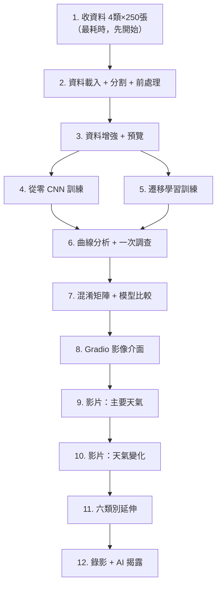

# CIS341 Project 1：天氣分類 — 執行規範

**總分 100 分｜截止 2026-11-15（日）23:59 HKT｜Python 3.12 + TensorFlow 2.16（CPU only）**

一句話總結：收集天氣照片 → 訓練兩個 CNN（從零 vs 遷移學習）→ 比較分析 → Gradio 介面 + 影片推論 → 擴充成六類別。

> 一切以英文原文 [CIS341-Project1-2627.md](CIS341-Project1-2627.md) 及課程公告為準。

---

## 0. 環境

| 項目 | 值 |
|------|-----|
| 虛擬環境 | `Project_1-Weather_Classification\.venv`（Python 3.12.10） |
| 套件清單 | [requirements.txt](requirements.txt) |
| 安裝 | `uv pip install --python .venv\Scripts\python.exe -r requirements.txt` |
| Jupyter kernel | `Python (cis341-project1)` |
| 硬體 | **CPU only**（`tf.config.list_physical_devices()` 只有 CPU） |

⚠️ **numpy 必須鎖在 1.26.4**：TensorFlow 2.16 在 Windows 上要求 `numpy<2`，升級到 2.x 會直接解析失敗。

⚠️ **CPU 訓練對策**：影像縮到 128×128、epoch 控制在 15–25、batch size 32，或改用 Colab（規格允許，但錄影要註明硬體）。

---

## 1. 資料收集（5%）

### 硬性要求

- **4 類 × ≥250 張互不重複的原始影像**（共 ≥1000 張）
- 增強後的副本**不計入**最低數量
- 必須記錄**來源與授權**
- 必須**親自檢視每張圖**，移除重複、擱置不明確案例
- Notebook 中列出「保留 / 剔除」範例 + 每類原始數量
- **上傳 OneDrive / Google Drive**，提供可存取連結 + 類別/分割清單

### 類別判定標準（嚴格）

| 類別 | 可接受 | 不可接受 |
|------|--------|---------|
| 晴天 Sunny | 明顯陽光、大致晴朗；零散雲朵 OK | — |
| 陰天 Overcast | 大範圍雲層、漫射光為主 | — |
| 雨天 Rainy | 可見雨勢，或足以令人信服的降雨證據 | **僅有濕滑路面** |
| 雪天 Snowy | 明顯積雪或降雪（含陽光下雪景） | **僅小片遠處積雪或結霜** |

### 扣分點

- 影像嚴重劣化/壓縮、損壞無法讀取
- 大量不相關或標籤錯誤
- 只給來源網站連結（❌ 必須給實際檔案）

---

## 2. 資料準備（15%）

### 2.1 載入、標籤、前處理（7.5%）

必須完成四項：

1. **分割訓練/驗證集**
   - 說明分割方式（建議分層抽樣 80/20）
   - 每類驗證集要有足夠樣本
   - **兩個模型必須使用完全相同的分割**
   - ⚠️ **防洩漏**：重複圖、同場景連拍必須放同一組

2. **建立 DataLoader + 預覽一個 batch**
   - 檢查：影像方向、顏色、batch 形狀、類別順序

3. **套用各模型的前處理**
   - 記錄：輸入尺寸、通道順序、縮放方式
   - 顯示實際 shape、dtype、數值範圍
   - ⚠️ 檢查預訓練模型**內部是否已含前處理**（如 MobileNet 內建 rescale）

4. **儲存類別順序並全程重用**
   - 驗證、Gradio、影片推論都必須用同一份前處理
   - ⚠️ **OpenCV 是 BGR，Keras 要 RGB** — 經典陷阱

### 2.2 資料增強（7.5%）

- 選能代表天氣照片合理變化的轉換
- **必須並列預覽**：原始 vs 每類增強後
- 檢查天氣特徵是否仍可見（裁切把雪裁掉就失敗）
- **只對訓練集做**，驗證集必須確定性
- ⚠️ **沒有預覽輸出 = 這 7.5% 直接歸零**

---

## 3. 模型設計（15%，各 7.5%）

### 模型 A：從零訓練 CNN（7.5%）

- 從隨機權重開始，卷積層 + 分類器一起訓練
- 可改編實驗課的 VGG 類模型
- 必須說明：卷積/池化階段設計、分類器結構
- 必須討論：**dropout / BatchNorm 用或不用，為什麼**
- 輸出必須是 4 類

### 模型 B：遷移學習（7.5%）

- 選一個預訓練模型（建議 MobileNetV2）
- **必須指出權重來源**（ImageNet）
- 換掉原分類器 → 4 類天氣分類器
- 必須說明：所需前處理、哪些層凍結/可訓練
- 凍結主幹 + 訓練分類頭 ✅ 可接受；微調為選項

### 兩者共同要求

- 顯示 `model.summary()` + 可訓練/總參數量
- 確認輸出維度 = 4
- **強烈建議**存成 `.keras` 檔（附類別順序 + 前處理設定）
- Notebook 必須能從提交的資料**重現兩次訓練**

---

## 4. 訓練與分析（30%）

### 4.1 訓練記錄

保留可見的：訓練程式碼、Keras 日誌、儲存的 `history`。

必須能辨識：optimizer、learning rate、batch size、epoch 數、checkpoint 選擇。
不用 Colab 時**必須註明硬體**。

### 4.2 訓練曲線與除錯

- 畫 loss / accuracy 曲線（訓練 vs 驗證）
- **用實際 epoch 與數值解釋**，不能只貼圖
- 判斷過擬合（訓練好驗證差）/ 欠擬合（兩者都差）

⚠️ **必須完成至少一次「調查」**：
1. 展示觀察到的問題或不確定結果
2. 說明所做的檢查/變更
3. 在**相同驗證案例**上重測比較
4. 說明固定了哪些條件

> 即使改失敗也有分 — 重點是「有做、有記錄、有比較」。

### 4.3 驗證與比較

- 在**同一驗證集**上評估兩個模型
- 報告：驗證 loss/accuracy、類別層級結果、**標註過的混淆矩陣**
- 建議表格：設定 / 選定 epoch / 驗證結果 / 訓練時間
- **必須論證部署哪個模型，為什麼**

### 4.4 自動品質基準測試（15%）

講師用**私人測試集**跑你的模型：

| 方法 | 及格 | 一般案例滿分 |
|------|------|-------------|
| 從零 CNN | ≥60% | **≥75%** |
| 遷移學習 | ≥70% | **≥85%** |

- 一般案例 12 分（各 6 分）；困難案例 3 分（各 1.5 分）
- 兩者都達標 → 保底 12/15

⚠️ **高驗證準確率 ≠ 私人測試高分**。訓練/驗證圖若來自相似來源會嚴重高估。收集時務必**多樣化來源**。

---

## 5. 影像介面（5%）

- Gradio 上傳圖片 → 用 `gr.Label` 顯示**全部 4 個具名機率**
- 每類至少一個測試案例：圖片 + 預期標籤 + 實際結果
- 標明該圖是「訓練 / 驗證 / 新資料」
- **妥善處理空白輸入**
- 錄影中示範一次真實預測

---

## 6. 影片推論（20%，四塊各 5%）

同一個影像模型用在影片上。

### 6.1 主要天氣預測（5%）

- **至少每秒取樣 1 幀**，涵蓋整段影片
- 顯示：取樣幀、時間戳、類別機率
- **對機率向量取平均**（⚠️ 不是對類別 ID 取平均）
- 報告平均後最大的類別

### 6.2 主要天氣 Gradio 介面（5%）

- 上傳影片 → 顯示主要天氣 + 4 個平均分數
- 用不同天氣測試，**包含一段天氣變化的影片**

### 6.3 天氣變化預測（5%）

- 每幀或每 N 幀預測，**1 ≤ N ≤ 5**（N 必須是參數）
- 記錄每次預測的時間/幀號
- 檢視預測是否跟隨天氣變化

### 6.4 天氣變化 Gradio 介面（5%）

- 輸出**標註後的影片** 或 **時間軸/長條圖**
- 指出天氣何時變化、每區間被指派什麼類別
- ⚠️ 保留每個輸出幀與原始時間
- ⚠️ 兩次模型呼叫之間**維持最新預測**（不要閃爍）

### 測試素材

所有測試影片皆放在 `videos/` 資料夾。

| 檔案 | 用途 |
|------|------|
| `videos/main-weather-sunny.mp4` | 主要天氣（晴天） |
| `videos/video2.mp4` | 8 秒天氣變化（合成，含全部 4 類） |
| `videos/common-changing-weather.mp4` | 真實錄影接合的天氣變化 |
| `videos/annotated-weather-example.mp4` | 標註輸出範例 |

⚠️ **預測必須真的來自模型**。整段重複用同一預測、或按時間戳硬編碼標籤 → 不給分。

---

## 7. 六類別分類器（10%）

- 在四類別完成後，**再加 2 個自選天氣狀況**
- 必須視覺上能與 4 個必需類別區分，且彼此也能區分
- ❌ 「小雨 vs 大雨」這種細微差異不算
- 每個新類別 **≥250 張**原始影像
- 訓練六類別版本，更新輸出層、類別順序、Gradio 顯示
- 展示全部 6 類的驗證結果與實際預測
- **與四類別基準比較**，解釋效能變化

### 分數邏輯

- 只做四類別 → 最多 **90 分**
- 完成六類別 → 開啟剩下 **10 分**

### 建議的新類別（視覺差異大）

霧天 Fog、雷雨/閃電 Thunderstorm、彩虹 Rainbow、沙塵/霧霾 Haze

---

## 8. 提交與錄影

### 必交項目

1. **已執行且儲存輸出的 `.ipynb`**
2. **英語旁白螢幕錄影（≤ 7 分 30 秒）**
3. 資料集連結（OneDrive/Google Drive，放在 notebook 頂端）
4. 類別/分割清單
5. 影片示範輸出
6. 訓練好的模型檔（選項，但強烈建議）

### 錄影必講 6 點

1. 資料來源與影像數量
2. 資料增強與準備（附預覽）
3. 兩個模型的設計原則
4. 超參數、驗證結果、曲線解讀、模型比較
5. 介面設計 + 一次真實預測 + 影片結果
6. 六類別延伸

⚠️ 用 OBS 或 Teams 錄，**不要用講堂錄影系統**。超時最多扣 5 分。

---

## 9. AI 使用揭露（⚠️ 最高扣 25 分）

**每個主要部分**都要揭露：資料收集、準備、模型設計、訓練/分析、介面/影片。

每項要寫：
- 用了哪個工具/代理
- 請它解決什麼**具體問題**
- 該建議**測試後是否有效**
- 你**採用或拒絕**了什麼

❌ 只寫「用 ChatGPT 協助寫程式」= 不足
❌ 聲稱沒做過的檢查 = 嚴重問題

---

## 10. 分數總覽

| 部分 | 分數 | 難度 | 備註 |
|------|-----:|------|------|
| 資料收集 | 5 | 中 | 1000+ 張圖，最耗時 |
| 資料載入/前處理 | 7.5 | 中 | BGR/RGB 陷阱 |
| 資料增強 | 7.5 | 低 | 沒預覽就 0 分 |
| 從零模型 | 7.5 | 中 | 需 ≥75% 才滿分 |
| 遷移模型 | 7.5 | 低 | 需 ≥85% 才滿分 |
| 論證分析 | 15 | **高** | 需真解釋 + 一次調查 |
| 自動基準測試 | 15 | **高** | 私人測試集，無法預測 |
| Gradio 影像 | 5 | 低 | |
| 影片 ×4 | 20 | **高** | 四塊分開評分 |
| 六類別 | 10 | 中 | 開啟最後 10 分 |
| **合計** | **100** | | |

---

## 11. 執行順序

---

## 12. 撰寫 notebook 時的規則

- 每個部分用 Markdown 標題開頭，說明「這節要做什麼、為什麼」
- 程式碼 cell 之後**必須有實際執行輸出**（未執行的 notebook 視為不完整提交）
- 圖表必須附**文字解讀**，不能只貼圖
- 類別順序、前處理參數集中定義一次，全程引用
- 每個主要部分結尾加一段 **AI 使用揭露**

---

## 13. 風險清單

| 風險 | 說明 | 對策 |
|------|------|------|
| 🔴 CPU only | 無 GPU，訓練慢 | 縮小影像、少 epoch、或用 Colab |
| 🔴 時間緊迫 | 11/15 截止 | 資料收集立刻開始 |
| 🟠 私人測試集 | 驗證高分不代表過關 | 收集多樣化來源 |
| 🟠 影片四塊各 5% | 容易漏做 | 先寫函式再包 Gradio |
| 🟡 AI 揭露 25 分 | 最容易忽略 | 邊做邊記錄，不要最後補 |