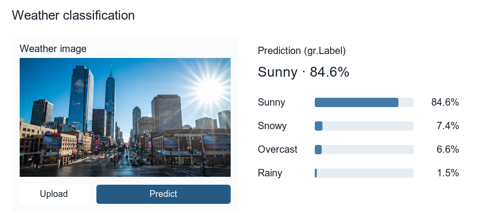

<!-- page 1 of 11 -->
# CIS341 Project 1: Weather classification
Total: 100 marks. The detailed rubric is in Appendix A of this specification.
## 1. Motivation (not separately graded)
In this project, we will build a system that recognises weather in photographs and moving video. We will
apply the CNN methods from our labs to a collection of images that we choose ourselves. This means we
must decide what makes a suitable training example, how to prepare it, and how to check whether the
resulting model works on new scenes.
Different model designs and ways of learning can produce different training behaviour and prediction
quality. We will compare a CNN trained from random weights with a model that reuses pretrained
features. The comparison should help us understand whether transfer learning is useful for our dataset,
how much training each approach needs, and which mistakes remain.
We will use training and validation curves to investigate overfitting or underfitting. We will then test new
images and video to see how those findings affect a working application. Our goal is to explain the results
and improve problems we observe.
## 2. Data collection (5%)
We will first compare models for four weather classes. You may choose two additional conditions for the
separate six-class section. Use the following meanings for the four-class task:
| Class | What the image should show |
| --- | --- |
| Sunny | A visibly sunlit, mostly clear scene. Scattered clouds are acceptable. |
| Overcast | Extensive cloud cover with mainly diffuse light. |
| Rainy | Visible rain or convincing combined evidence of rain. A wet road alone is insufficient. |
| Snowy | Substantial snow cover or snowfall, including snow in sunshine. Small distant patches or frost alone are insufficient. |
You may use your own photographs or public sources such as Wikimedia Commons and Kaggle. Record
the sources and licences. Since source labels can be wrong, you must inspect the images, remove
duplicates and set aside unclear cases. Include kept/rejected examples and the original count for each
class in your notebook.
Collect at least 250 distinct, usable images per class before augmentation. The same minimum
applies to each additional class if you attempt the six-class extension. Augmented copies do not count
towards the minimum.
Collection marks cover the required number of images, source records and accessible data. We may
deduct for obvious faults, such as severe image degradation or compression, corrupted files, or a
substantial number of irrelevant or incorrectly labelled images. Otherwise, classification quality is
assessed through the trained models' results in Section 5.
Upload the dataset you actually used to Microsoft OneDrive or Google Drive and give your
lecturer an accessible download link. Include a file listing with each image's class and
training/validation split. We need these files to reproduce your preparation and check your results. Keep
them accessible until marking and any follow-up checks are complete. A source website alone does not
identify your exact collection. Missing data loses the marks described in Appendix A.

<!-- page 2 of 11 -->
## 3. Preparing your data (15%)
Before training, we need to check what the models will actually receive. Incorrect labels, colours or
scaling can spoil an experiment even when the model code runs.
### 3.1 Data loading, labels and preprocessing (7.5%)
1. Unpack the data and divide it into training and validation sets. Choose and explain your split, with
enough images from every class for meaningful validation. Use the same membership for both
models. Keep duplicates and related images together so they cannot leak between sets.
2. Build the data loaders and preview a loaded batch with its labels. Check image orientation, colours,
batch shape and class order.
3. Apply the preprocessing required by each model. Record input size, channel order and scaling, and
show an actual input's shape, data type and range. Check whether preparation is already included
inside a pretrained model.
4. Save the class order and reuse the correct preparation in validation, Gradio and video inference.
Check the same image through direct prediction and the interface. With OpenCV, account for BGR
versus RGB.
The lecturer will prepare the final test set separately. Your own validation data should help you identify
problems before that test.
### 3.2 Augmentation methods and previews (7.5%)
Choose transformations that represent plausible variation in weather photographs and explain your
choices. Show originals beside actual augmented versions from every class. Check that the weather
remains visible, for example that cropping has not removed the snow or a rotation has not made the
scene unrealistic.
Apply augmentation to training data only; keep validation preparation deterministic. The augmentation
must be used in the executed training path. Code without the preview outputs does not complete this
part.
## 4. Model design: two approaches (15%, 7.5% per model)
We will compare two ways of learning weather features. Both models are required.
| Approach | What you must build and explain |
| --- | --- |
| CNN trained from scratch | Start with random weights and train both the convolutional layers and classifier. |
| Transfer learning | Choose a pretrained model, identify its weight source, and replace its original classifier with a four-class weather classifier. |
Show each model's summary and trainable/total parameter counts. Check that its output matches the
four classes. We strongly recommend submitting your trained scratch and transfer models, for
example as .keras files, with their class order and preprocessing settings. This lets the lecturer load

<!-- page 3 of 11 -->
them and run the final test without retraining on your dataset. Model files are optional; the notebook must
still reproduce both training runs from your submitted data.
## 5. Model training and analysis (30%, 15% justification, 15% benchmark)
Your justification accounts for 15%; the automatic quality benchmark accounts for 15%. Sections
5.1 to 5.3 explain what to include in your justification.
### 5.1 Training records
Keep the training code, Keras logs and saved history visible for both models. We should be able to
identify the optimizer, learning rate, batch size, completed epochs and checkpoint selection. You do not
need to retype information already shown there. If you train outside Colab, also identify the hardware.
### 5.2 Training curves and debugging
Plot training/validation loss and accuracy for each model. Explain the curves using actual epochs and
values. Improving training results with worsening validation results can indicate overfitting; poor
performance on both sets can suggest underfitting or a preparation problem.
Try to address problems before submitting. Complete at least one investigation: show an observed
problem or uncertain result, explain a check/change, and compare the retest on the same validation
cases. State what you held fixed. You might change augmentation, model size, regularization or learning
rate. If the issue remains unresolved, explain what you tried and what still fails.
### 5.3 Validation and comparison
Evaluate the selected version of each trained model on the same validation set. If you use saved
checkpoints, reload the selected checkpoint for this evaluation. Report validation loss/accuracy,
class-level results and labelled confusion matrices, including correct predictions and mistakes.
A table of settings, selected epochs, validation results and training times is suggested to help your
explanation in the recording. Another clear presentation is acceptable. Justify which model you would
deploy and acknowledge differences in architecture or settings that may affect the comparison.
We grade whether the records and results support your reasoning. A plot without interpretation, an
untested proposed fix or a claim that contradicts the output will lose justification marks.
### 5.4 Automatic quality benchmark (15%)
The lecturer will test both four-class models on a separately prepared private image dataset.
These automatic results determine the 15% benchmark component. The test images will not be
released in advance.
The ordinary cases account for 12 marks, six per model. These show clear examples of the four
required weather conditions. The remaining three marks, 1.5 per model, assess harder cases, such as
less familiar viewpoints or lighting. The weather must still be identifiable; ambiguous images will be
excluded.
| Approach | Pass-level guidance on ordinary cases | Accuracy securing all six ordinary-case marks |
| --- | --- | --- |
| CNN trained from scratch | At least 60% accuracy | At least 75% accuracy |
| Transfer learning | At least 70% accuracy | At least 85% accuracy |

<!-- page 4 of 11 -->
These expectations apply to the ordinary cases in the lecturer's private test. Meeting both right-hand
targets guarantees at least 12/15 (80%) for this benchmark component. Performance on the harder
cases can earn the remaining three marks. Your justification and other project work are assessed
separately.
Your own validation accuracy may be higher than the private-test result, particularly when training and
validation photographs come from similar sources. Check varied scenes and inspect errors in every class
before submitting; a high validation score alone does not establish that the model generalises well.
## 6. Improvements: image interface and video (25%)
### Image interface (5%)
We will make the classifier usable through a Gradio interface. An uploaded image should produce named
weather scores so that a user can inspect the prediction and its confidence.
Use your selected model and display all four probabilities with gr.Label. Save tests for every class,
showing the image, expected label and actual result. Identify whether each image is training, validation or
new data. Handle an empty input sensibly and demonstrate one real prediction in your recording.
This layout illustrates an image prediction and its class scores. Your model's scores may differ; you may
arrange the interface differently if the result remains clear.
### Video inference (20%, four parts of 5%)
A single image tells us about one moment. For a video, we may want either the main weather across the
clip or an answer that changes as the scene changes. We will implement both, using the same
image-classification model on decoded frames.
| Part | What you must implement | Marks |
| --- | --- | ---: |
| Main-weather prediction | Sample the whole video at least once per second. Show sampled frames, timestamps and class probabilities. Average the probability vectors from all samples and report the class with the largest mean. | 5 |
| Gradio interface for main weather | Accept a video and display its main weather and four averaged class scores. Test the interface with different weather conditions, including a changing-weather clip. | 5 |
| Changing-weather prediction | Predict on every frame, or every N frames with 1 <= N <= 5. Make N a parameter and record the time/frame of each prediction so that we can see how the result changes. | 5 |
| Gradio interface for changing weather | Accept a video and show either an annotated output video or a custom timeline/bar indicating when the weather changes and the class assigned to each interval. | 5 |
> 本頁圖片資產：
> **Figure 4.1**
>
> 

<!-- page 5 of 11 -->

The following Moodle attachments are reference anchors for testing your video pipeline. All of them
are stored in the `videos/` folder:
 videos/main-weather-sunny.mp4: a clip for checking the main-weather result.
 videos/video2.mp4: an eight-second changing-weather reference video.
 videos/common-changing-weather.mp4: additional changing-weather footage.
 videos/annotated-weather-example.mp4: an annotated reference output, provided as a display example.
The eight-second reference sequence is synthesised for demonstration; the other changing clip joins
genuine recordings. Both are suitable for these tests. You may put the two interface functions in one
Gradio application with separate modes or tabs.
We use these moving sequences to check how predictions respond over time. In the basic task, sampling
must cover the full clip at a rate of at least one frame per second. In the changing-weather task, the much
shorter interval of at most five frames lets us inspect changes more closely. Average probabilities rather
than class-ID numbers, and obtain predictions from the model rather than hard-coded timestamps.
Example annotation from the supplied reference output. You may use another clear placement or choose
the timeline/bar alternative.
When producing an annotated video, preserve every output frame and the original timing. Hold the latest
prediction on frames between model calls. If you use a timeline instead, show the original video
alongside the weather intervals. Check that the result is readable and explain incorrect or delayed
predictions. The four video components are graded separately, so demonstrate each one.

> 本頁圖片資產：
> **Figure 5.1**
>
> 

<!-- page 6 of 11 -->
## 7. Six-class classifier (10%)
After completing the four-class comparison, extend your selected approach to recognise two additional
weather conditions of your choice. They must be visually distinguishable from the required classes and
from each other. Slight variations such as "light rain" and "heavy rain" do not count as two new
conditions. Define your chosen labels and show examples so that we can understand and test the
distinction.
Include at least 250 usable originals for each additional class. Start with the four-class system and
inspect its results before extending it. More classes can introduce confusion and reduce accuracy, so you
may need more varied data or further training.
Train a six-class version of the selected model and update its output layer, saved class order and Gradio
display. Show predictions and validation results for all six classes, including both new conditions.
Compare it with the four-class baseline and explain any change in performance.
We will evaluate this model on all six classes, including independent images of your two declared
conditions. This section rewards a working classifier supported by its benchmark results; adding two
folders alone does not earn the 10%. The provided videos cover the original conditions, so also
demonstrate suitable image inputs for both new classes.
This section is part of the 100% project total. A complete four-class submission can earn up to 90%;
completing the six-class work opens the remaining 10%.
## Grading scheme

| Work | Marks |
| --- | ---: |
| Data collection, inspection and accessible dataset | 5 |
| Data loading, label assignment, input range and preprocessing | 7.5 |
| Augmentation methods and previews | 7.5 |
| Scratch model: design and demonstrated training | 7.5 |
| Transfer model: design and demonstrated training | 7.5 |
| Justification: training records, analysis, debugging and comparison | 15 |
| Automatic quality benchmark for the four-class models | 15 |
| Gradio image interface and tests | 5 |
| Video: main-weather prediction | 5 |
| Video: Gradio main-weather interface | 5 |
| Video: changing-weather prediction | 5 |
| Video: Gradio changing-weather interface | 5 |
| Working six-class classifier and benchmark results | 10 |
| **Total** | **100** |
Appendix A gives the marks for each requirement and the consequences of missing work. For example,
missing previews lose preview marks, and missing curve explanations lose analysis marks. Code without

<!-- page 7 of 11 -->
execution evidence earns only the relevant implementation marks. Claims must agree with the submitted
outputs.
## Submission requirements
Submit one executed .ipynb notebook with saved outputs, plus one screen recording with your own
English voiceover. Your dataset and class/split listing are required; provide accessible OneDrive or
Google Drive links at the top of the notebook. Include your video demonstration outputs as files or links.
Trained model files are optional but strongly recommended. Providing both models, their class order and
preprocessing settings lets us test them directly without retraining. You may place them in the same
shared folder as the dataset.
In your recording, explain:
1. Your data sources and the number of images used.
2. Your augmentation and data preparation, with previews.
3. The design principles behind both models.
4. Training hyperparameters, validation loss/accuracy, curve interpretation and the model comparison.
5. Your interface design and a real prediction, followed by the video results.
6. Your six-class extension, if attempted.
Keep the entire recording under 7 minutes 30 seconds, including the six-class demonstration.
Show saved training results and demonstrate inference; you do not need to rerun the full notebook.
PowerPoint slides are suggested, but you may present directly from the notebook. No separate report is
required.
Use OBS or record your own Teams meeting on your computer. Do not use the lecture-room recording
system. You may edit out waiting, while identifying saved results and replayed footage. Check that the
finished recording is audible and readable.
Please keep the recording and generated video files small while preserving readable labels and clear
audio. If a video is too large to upload to Moodle, host it on OneDrive and include an accessible link in
your submission. Keep shared files available until marking and follow-up checks are complete.
## AI disclosure
We allow AI assistance, but need to understand what you delegated and what you checked yourself.
Disclosure is mandatory for each major section: data collection, preparation, model design,
training/analysis, and interface/video.
Explain in the notebook or recording which tool/agent you used, the specific problem you asked it to
solve, and whether the suggestion worked when you tested it. Include what you used or rejected. If you
did not use AI, state that.
Missing or inadequate disclosure can lose up to 25 percentage points across the project. A tool
name followed by "helped with coding" is insufficient. Do not claim checks you have not performed.
## Deadline and submission checks
Submit by Sunday, 15 November 2026, 23:59 (Hong Kong time, UTC+8).
Please click "Submit assignment" on Moodle and confirm that the status is "Submitted for grading". An
attempt left in draft status is not a completed submission.

<!-- page 8 of 11 -->
We will check submissions immediately after the deadline. Your files and shared links must open, your
demonstration video must be accessible, and your notebook must contain executed outputs with enough
evidence of the results you report. Unreadable files, a missing video, an unexecuted notebook or
insufficient evidence make the submission incomplete.
Course late-submission penalties still apply to incomplete submissions, even if files were
uploaded before the deadline. Any further instructions will be given in your grading comments.
All assessed work is included in the 100% allocation. There are no bonus marks.
## Appendix A: marking rubric
## A.1 What we will assess
#### Data collection (5%)
 Use at least 250 distinct, usable images for each class and record your sources and counts.
Augmented or duplicate copies do not count as additional originals.
 Dataset deductions are limited to obvious faults, such as severe degradation or compression,
unreadable files, or a substantially irrelevant or incoherently labelled collection. Otherwise, the trained
models' results determine classification quality.
 Provide the actual data on OneDrive or Google Drive, together with the class/split listing, and keep it
accessible for reproduction.
#### Data preparation (15%)
 Data loading and preprocessing (7.5%): produce correctly labelled batches and a useful
training/validation split without duplicate leakage. Show the loaded inputs, including their shape, data
type and range. Use the correct preprocessing for each model and preserve it, along with the class
order, in validation and inference.
 Augmentation (7.5%): choose and explain suitable transformations, preview originals beside
augmented examples from every class, and use the transformations during training. Missing previews
lose credit even if augmentation code is present. Validation images must not receive random
augmentation.
#### Model design and training (15%, 7.5% per model)
 Scratch model (7.5%): train a CNN from random weights. Explain the convolution/pooling stages and
classifier, including choices such as dropout or batch normalization where appropriate. The loss and
output must suit the four-class task.
 Transfer model (7.5%): train a replacement weather classifier using pretrained features. Explain the
required preprocessing, classification head and choice of frozen/trainable layers. Fine-tuning is
optional; a working frozen backbone with a trained head is acceptable.
 Keep model summaries and parameter counts visible, with execution evidence for both training runs.
We cannot give full training credit for a model definition that was never trained.
 The notebook must reproduce both models from the submitted dataset. We strongly recommend
including trained model files and checking that they load successfully, but uploading those files is
optional. Lab-derived designs are acceptable; extra layers or fine-tuning do not earn marks on their
own.

<!-- page 9 of 11 -->
Justification (15%)
 Retain training settings, logs and histories for both models. Explain their training/validation curves
using the results actually shown, identify possible overfitting, underfitting or preparation faults, and
justify checkpoint selection.
 Evaluate both trained models on the same validation set and discuss class-level successes and
failures, supported by labelled confusion matrices and example predictions.
 Complete a meaningful investigation with an observed issue, an explained check/change, and an
actual retest. We will assess whether the comparison supports your conclusion. An unsuccessful but
carefully tested change is more informative than an unsupported success claim.
 Compare the two approaches clearly and justify your deployment choice. A table is suggested to help
your explanation, but another clear presentation is acceptable.
Automatic quality benchmark (15%)
 The lecturer will test both four-class models on privately prepared images. Ordinary cases receive 12
marks, six per model; harder cases receive three marks, 1.5 per model. Classification accuracy is
assessed against the separate scratch and transfer expectations in Section 5.4.
 Meeting both ordinary-case targets secures 12/15 for this component. The harder cases determine
the remaining three marks.
 High training or validation accuracy does not replace the private test. Check that your submitted
model or reproducible notebook uses the declared class order and preprocessing.
### Image interface (5%)
 The Gradio interface must use the selected model, apply the correct preprocessing and show all four
named scores through gr.Label.
 Demonstrate actual predictions across the classes, with readable inputs and expected/actual
answers. An interface launch alone does not establish that prediction works.
Video inference (20%)
 Main-weather prediction (5%): sample the full clip at least once per second and average the class
probabilities from all samples. Show enough timestamps and outputs for us to verify the calculation.
 Main-weather Gradio interface (5%): accept a video and display its main weather and averaged class
scores. Demonstrate that it works with different weather conditions.
 Changing-weather prediction (5%): infer on every frame or every N frames, with N exposed as a
parameter between 1 and 5. Record predictions against time and inspect whether they follow the
weather changes.
 Changing-weather Gradio interface (5%): accept a video and display either a readable annotated
video or a timeline/bar showing the weather assigned to each time interval. Check that the display
matches the input video and preserves its timing.
 The two interfaces may share one Gradio application. We assess their respective outputs separately.
A successful export with incorrect weather throughout does not demonstrate successful classification.

<!-- page 10 of 11 -->
Six-class classifier (10%)
 Extend the selected approach to the four required classes and two additional conditions of your
choice, with suitable data, a matching classifier and an updated Gradio display. The new conditions
must be visually distinct from the required classes and from each other.
 Show validation results and actual predictions for all six classes. Compare with your four-class
baseline and explain any deterioration or remaining confusion.
 We will benchmark all six classes. The marks depend on a working extension and its classification
quality; collecting two extra folders without training and testing does not complete this section.
## A.2 Assessing the videos
 We will use video2.mp4 as a reference for testing. Compare predicted weather with the visible
conditions in the footage and explain uncertain predictions around transitions.
 The additional genuine-footage clip also contains all four classes. Check its short Rainy segment
using your chosen frame interval, which must not exceed five frames for changing-weather prediction.
 Predictions must come from the model. Reusing one prediction for the entire changing clip or
hard-coding labels from timestamps does not demonstrate changing-weather inference.
 We will inspect the labels that viewers actually see, including held predictions between fresh model
calls. Clear segments should be classified sensibly, and mistakes or lag should be discussed.
 Your output need not reproduce the lecturer's example probabilities exactly. We will assess
correctness, readability and whether your explanation agrees with your own results.
## A.3 Missing work and unsupported claims
 Missing or inaccessible required data, notebooks or demonstration outputs reduce the marks for work
we cannot reproduce or verify. Optional trained model files do not carry a separate submission
requirement.
 Draft attempts and incomplete or invalid submissions remain subject to course late-submission
penalties, as explained in the deadline requirements.
 An unimplemented or untrained required model, missing augmentation previews, absent curve
explanations or an unexecuted retest loses the corresponding task credit.
 Data leakage, incompatible labels or incorrect preprocessing can invalidate reported performance.
We will assess what the submitted system actually does.
 A proposed fix without results is not a completed improvement. Claims that conflict with the notebook
or recording receive no credit for the experiments they purport to describe.
 We will retain credit for valid work and avoid an extra flat penalty for a fault already reflected in its
criterion.
## A.4 AI disclosure and recording length
 Explain AI use for each major section, including the tool, the specific problem and your verification of
the outcome. Missing, generic or misleading disclosure may lose up to 25 percentage points in total.
No disclosure throughout the project receives the maximum deduction.
 Keep the full English-voiceover recording under 7 minutes 30 seconds. Overlength recordings may
lose up to five marks.
 All assessed work, including the six-class extension, is within the 100% allocation. There are no
bonus marks. Disclosure, duration and normal course deductions apply to the resulting total.

<!-- page 11 of 11 -->
 We assess the technical explanation, without separate marks for accent, webcam use, editing polish
or slide design.
Appendix B: supplied video credits
The eight-second video2.mp4 and annotated-weather-example.mp4 are reference anchors for testing
and displaying predictions. The sequence is synthesised to include all four weather conditions. The
mockups use frames and prediction values from these files.
The annotated example is supplied as an H.264 MP4 for browser playback, preserving the annotations
and eight-second timing.
The additional Sunny and genuine-footage changing clips below were trimmed, scaled with preserved
aspect ratio and padding, converted to 30 FPS H.264 MP4, and stripped of audio. The genuine-footage
changing clip joins the excerpts with hard cuts. Original scene order within each excerpt was retained.
 Sunny: Toshio Suzuki / Bureau of Land Management Oregon & Washington, Sunny spring day on the
Sandy River, Commons source. Public domain under PD US BLM.
 Overcast: YusufuAM, Cloudy, CC BY-SA 4.0.
 Rainy: Photographs by Gnangarra...commons.wikimedia.org, Rain falling on road, CC BY 2.5
Australia.
 Snowy: WarDestroyer88, Snowstorm2021, CC BY-SA 4.0.
The genuine-footage joined export and original contributions to it are distributed under CC BY-SA 4.0.
The fully Sunny derivative remains public domain. Source licences remain applicable; no endorsement is
implied.
