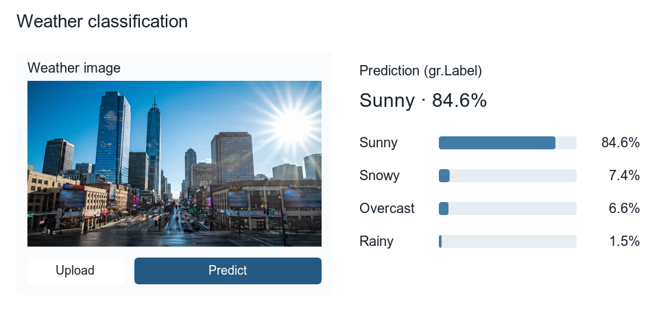

<!-- page 1 of 11 -->
# CIS341 專題一：天氣分類

> 本文件為 [CIS341-Project1-2627.md](CIS341-Project1-2627.md) 的繁體中文翻譯版，僅供閱讀參考；一切以英文原文及課程公告為準。

總分：100 分。詳細評分標準見本規格附錄 A。

## 1. 動機（不單獨評分）

本專題中，我們將建立一個能辨識照片與動態影片中天氣狀況的系統。我們會把實驗課學到的 CNN 方法，套用到自己挑選的一組影像上。這意味著我們必須決定什麼才算合適的訓練樣本、如何準備這些樣本，以及如何檢查訓練出來的模型能否在新場景中正常運作。

不同的模型設計與學習方式，會產生不同的訓練行為與預測品質。我們會比較「從隨機權重開始訓練的 CNN」與「重用預訓練特徵的模型」。這項比較應有助於我們理解：遷移學習對我們的資料集是否有用、每種方法需要多少訓練量，以及仍會留下哪些錯誤。

我們會利用訓練與驗證曲線來調查過擬合或欠擬合。接著再以新的影像與影片測試，觀察這些發現如何影響實際運作的應用程式。我們的目標是解釋結果，並改善我們觀察到的問題。

## 2. 資料收集（5%）

我們會先比較四種天氣類別的模型。你可以為獨立的六類別部分另外選擇兩種天氣狀況。四類別任務請採用以下定義：

| 類別 | 影像應呈現的內容 |
| --- | --- |
| 晴天（Sunny） | 明顯有陽光照射、大致晴朗的場景。零散雲朵可以接受。 |
| 陰天（Overcast） | 大範圍雲層覆蓋，光線主要為漫射光。 |
| 雨天（Rainy） | 可見的雨勢，或足以令人信服的綜合降雨證據。僅有濕滑路面並不足夠。 |
| 雪天（Snowy） | 明顯的積雪或降雪，包括陽光下的雪景。僅有小片遠處積雪或結霜並不足夠。 |

你可以使用自己拍攝的照片，或 Wikimedia Commons、Kaggle 等公開來源。請記錄來源與授權。由於來源標籤可能出錯，你必須親自檢視影像、移除重複項目，並把不明確的案例擱置。請在 notebook 中列出保留／剔除的範例，以及每個類別的原始數量。

在資料增強之前，每個類別至少需收集 250 張互不相同且可用的影像。若你嘗試六類別延伸，每個新增類別也適用相同的最低數量。增強後的副本不計入最低數量。

資料收集分數涵蓋所需影像數量、來源記錄與可存取的資料。對於明顯的缺失，例如嚴重的影像劣化或壓縮、損壞的檔案，或大量不相關或標籤錯誤的影像，我們可能會扣分。除此之外，分類品質會透過第 5 節中訓練模型的結果來評估。

請把你實際使用的資料集上傳到 Microsoft OneDrive 或 Google Drive，並提供講師可存取的下載連結。請附上檔案清單，列出每張影像的類別與訓練／驗證分割。我們需要這些檔案來重現你的準備流程並檢查你的結果。請保持可存取，直到評分及任何後續檢查完成為止。僅提供來源網站並不足以辨識你實際收集的資料。缺少資料將失去附錄 A 所述的分數。

<!-- page 2 of 11 -->
## 3. 準備你的資料（15%）

在訓練之前，我們需要檢查模型實際會接收到什麼。即使模型程式碼能執行，錯誤的標籤、顏色或縮放仍可能毀掉整個實驗。

### 3.1 資料載入、標籤與前處理（7.5%）

1. 解壓資料並分割為訓練集與驗證集。選擇並說明你的分割方式，確保每個類別都有足夠影像可供有意義的驗證。兩個模型必須使用相同的成員劃分。請把重複影像與相關影像放在同一組，避免它們在訓練集與驗證集之間洩漏。
2. 建立資料載入器，並預覽一個已載入的批次及其標籤。檢查影像方向、顏色、批次形狀與類別順序。
3. 套用每個模型所需的前處理。記錄輸入尺寸、通道順序與縮放方式，並顯示實際輸入的形狀、資料型別與數值範圍。檢查預訓練模型內部是否已包含前處理。
4. 儲存類別順序，並在驗證、Gradio 與影片推論中重用正確的前處理。請以直接預測與介面兩種方式檢查同一張影像。使用 OpenCV 時，須注意 BGR 與 RGB 的差異。

講師會另行準備最終測試集。你自己的驗證資料應有助於在該測試之前找出問題。

### 3.2 資料增強方法與預覽（7.5%）

選擇能代表天氣照片合理變化的轉換方式，並說明你的選擇。請把原始影像與每個類別實際增強後的版本並列展示。檢查天氣特徵是否仍然可見，例如裁切是否把雪移除了，或旋轉是否讓場景變得不真實。

資料增強只套用於訓練資料；驗證資料的準備必須保持確定性。增強必須實際用於已執行的訓練流程中。沒有預覽輸出的程式碼不算完成此部分。

## 4. 模型設計：兩種方法（15%，每個模型 7.5%）

我們會比較兩種學習天氣特徵的方式。兩個模型都是必需的。

| 方法 | 你必須建立並說明的內容 |
| --- | --- |
| 從零訓練的 CNN | 從隨機權重開始，同時訓練卷積層與分類器。你可以改編實驗課的 VGG 類模型。說明你的卷積／池化階段與分類器如何適合此任務。在適當處討論 dropout 或批次正規化等選擇，包括你為何使用或省略它們。 |
| 遷移學習 | 選擇一個預訓練模型，指出其權重來源，並把原本的分類器替換為四類別天氣分類器。說明該模型所需的前處理，以及哪些層會被訓練或保持凍結。為分類頭及你使用的任何 dropout 或批次正規化提出理由。凍結的預訓練主幹搭配已訓練的天氣分類器是可接受的；微調則為選項。 |

請展示每個模型的摘要與可訓練／總參數量。檢查其輸出是否符合四個類別。我們強烈建議提交你訓練好的從零模型與遷移模型，例如以 `.keras` 檔案形式，並附上類別順序與前處理設定。這讓講師能載入

<!-- page 3 of 11 -->
它們，並在無需以你的資料集重新訓練的情況下執行最終測試。模型檔案為選項；notebook 仍必須能從你提交的資料重現兩次訓練。

## 5. 模型訓練與分析（30%，15% 論證、15% 基準測試）

你的論證佔 15%；自動品質基準測試佔 15%。第 5.1 至 5.3 節說明論證中應包含的內容。

### 5.1 訓練記錄

請為兩個模型保留可見的訓練程式碼、Keras 日誌與儲存的歷史記錄。我們應能辨識最佳化器、學習率、批次大小、完成的 epoch 數與檢查點選擇。你不需要重新輸入已顯示的資訊。若你在 Colab 以外訓練，也請指出硬體。

### 5.2 訓練曲線與除錯

為每個模型繪製訓練／驗證損失與準確率。請以實際的 epoch 與數值解釋曲線。訓練結果改善但驗證結果變差，可能表示過擬合；兩者表現都差，則可能表示欠擬合或資料準備有問題。

請在提交前嘗試解決問題。至少完成一次調查：展示觀察到的問題或不確定的結果、說明所做的檢查／變更，並在相同的驗證案例上比較重測結果。請說明你固定了哪些條件。你可以改變資料增強、模型大小、正規化或學習率。若問題仍未解決，請說明你嘗試了什麼，以及仍有什麼失敗。

### 5.3 驗證與比較

在相同的驗證集上評估每個已訓練模型的選定版本。若你使用儲存的檢查點，請為此評估重新載入選定的檢查點。報告驗證損失／準確率、類別層級結果，以及標註過的混淆矩陣，包括正確預測與錯誤。

建議使用一張包含設定、選定 epoch、驗證結果與訓練時間的表格，以協助你在錄影中的說明。其他清楚的呈現方式也可接受。請論證你會部署哪個模型，並說明架構或設定上可能影響比較的差異。

我們評分的是記錄與結果是否支持你的推理。沒有解讀的圖表、未經測試的建議修正，或與輸出矛盾的說法，都會失去論證分數。

### 5.4 自動品質基準測試（15%）

講師會在另行準備的私人影像資料集上測試兩個四類別模型。這些自動結果決定 15% 的基準測試分數。測試影像不會事先公布。

一般案例佔 12 分，每個模型 6 分。這些是四種必需天氣狀況的清楚範例。其餘 3 分（每個模型 1.5 分）評估較困難的案例，例如較不熟悉的視角或光線。天氣仍必須可辨識；模糊的影像會被排除。

| 方法 | 一般案例的及格指引 | 取得全部六個一般案例分數的準確率 |
| --- | --- | --- |
| 從零訓練的 CNN | 至少 60% 準確率 | 至少 75% 準確率 |
| 遷移學習 | 至少 70% 準確率 | 至少 85% 準確率 |

<!-- page 4 of 11 -->
這些期望適用於講師私人測試中的一般案例。同時達到右側兩個目標，即可保證此基準測試部分至少獲得 12/15（80%）。較困難案例的表現可取得其餘 3 分。你的論證與其他專題工作會分開評估。

你自己的驗證準確率可能高於私人測試結果，尤其是當訓練與驗證照片來自相似來源時。提交前請檢查多樣化的場景，並檢視每個類別的錯誤；單靠高驗證分數並不能證明模型泛化良好。

## 6. 改進：影像介面與影片（25%）

### 影像介面（5%）

我們會透過 Gradio 介面讓分類器可供使用。上傳的影像應產生具名的天氣分數，讓使用者能檢視預測結果及其信心程度。

使用你選定的模型，並以 `gr.Label` 顯示全部四個機率。為每個類別儲存測試，顯示影像、預期標籤與實際結果。指出每張影像是訓練、驗證或新資料。請妥善處理空白輸入，並在錄影中示範一次真實預測。

此版面示範影像預測及其類別分數。你的模型分數可能不同；只要結果清楚，你可以採用不同的介面安排。

### 影片推論（20%，四個部分各 5%）

單一影像只告訴我們一個瞬間。對於影片，我們可能想要整段影片的主要天氣，或想要一個隨場景變化而改變的答案。我們會實作兩者，並在解碼後的影格上使用同一個影像分類模型。

| 部分 | 你必須實作的內容 | 分數 |
| --- | --- | ---: |
| 主要天氣預測 | 至少每秒取樣整段影片一次。顯示取樣的影格、時間戳與類別機率。對所有取樣的平均機率向量取平均，並報告平均值最大的類別。 | 5 |
| 主要天氣的 Gradio 介面 | 接受影片並顯示其主要天氣與四個平均類別分數。以不同天氣狀況測試介面，包括一段天氣變化的影片。 | 5 |
| 天氣變化預測 | 對每一影格預測，或每 N 個影格預測一次，其中 1 <= N <= 5。把 N 設為參數，並記錄每次預測的時間／影格，讓我們能看到結果如何變化。 | 5 |
| 天氣變化的 Gradio 介面 | 接受影片並顯示標註後的輸出影片，或自訂的時間軸／長條圖，指出天氣何時變化以及每個區間被指派的類別。 | 5 |

> 本頁圖片資產：
> **圖 4.1**
>
> 

<!-- page 5 of 11 -->

以下 Moodle 附件是測試影片流程的參考基準：

所有測試影片皆放在 `videos/` 資料夾。

- `videos/main-weather-sunny.mp4`：用於檢查主要天氣結果的片段。
- `videos/video2.mp4`：八秒的天氣變化參考影片。
- `videos/common-changing-weather.mp4`：額外的天氣變化影片素材。
- `videos/annotated-weather-example.mp4`：作為顯示範例提供的標註參考輸出。

使用晴天片段進行基本預測，並使用兩段變化影片測試天氣變化預測。八秒的參考序列是為示範而合成；另一段變化影片則接合了真實錄影。兩者都適合這些測試。你可以把兩個介面函式放在同一個 Gradio 應用程式中，以不同模式或分頁區分。

我們使用這些動態序列來檢查預測如何隨時間回應。在基本任務中，取樣必須以至少每秒一個影格的速率涵蓋整段影片。在天氣變化任務中，最多五個影格的較短間隔讓我們能更仔細地檢視變化。請對機率取平均，而不是對類別 ID 數字取平均，並從模型取得預測，而不是使用硬編碼的時間戳。

以下為所提供參考輸出的標註範例。你可以使用其他清楚的位置，或選擇時間軸／長條圖的替代方案。

製作標註影片時，請保留每一個輸出影格與原始時間。在模型呼叫之間的影格上，維持最新的預測。若你改用時間軸，請把原始影片與天氣區間並列顯示。檢查結果是否易讀，並解釋錯誤或延遲的預測。四個影片元件分開評分，因此請逐一示範。

> 本頁圖片資產：
> **圖 5.1**
>
> 

<!-- page 6 of 11 -->
## 7. 六類別分類器（10%）

完成四類別比較後，把你選定的方法延伸，以辨識你自選的另外兩種天氣狀況。它們必須在視覺上能與必需類別區分，且彼此之間也能區分。像「小雨」與「大雨」這類細微變化，不算兩種新狀況。請定義你選擇的標籤並展示範例，讓我們能理解並測試其區別。

每個新增類別至少需包含 250 張可用的原始影像。請先從四類別系統開始，檢視其結果後再進行延伸。更多類別可能帶來混淆並降低準確率，因此你可能需要更多樣化的資料或進一步訓練。

訓練所選模型的六類別版本，並更新其輸出層、儲存的類別順序與 Gradio 顯示。展示全部六個類別的預測與驗證結果，包括兩個新狀況。與四類別基準比較，並解釋任何效能變化。

我們會在全部六個類別上評估此模型，包括你所宣告兩種狀況的獨立影像。本節獎勵有基準結果支持的可用分類器；只增加兩個資料夾並不能獲得這 10%。所提供的影片涵蓋原始狀況，因此也請示範兩個新類別合適的影像輸入。

本節屬於 100% 專題總分的一部分。完整的四類別提交最多可獲得 90%；完成六類別工作可開啟其餘 10%。

## 評分方案

| 工作項目 | 分數 |
| --- | ---: |
| 資料收集、檢視與可存取的資料集 | 5 |
| 資料載入、標籤指派、輸入範圍與前處理 | 7.5 |
| 資料增強方法與預覽 | 7.5 |
| 從零模型：設計與示範訓練 | 7.5 |
| 遷移模型：設計與示範訓練 | 7.5 |
| 論證：訓練記錄、分析、除錯與比較 | 15 |
| 四類別模型的自動品質基準測試 | 15 |
| Gradio 影像介面與測試 | 5 |
| 影片：主要天氣預測 | 5 |
| 影片：Gradio 主要天氣介面 | 5 |
| 影片：天氣變化預測 | 5 |
| 影片：Gradio 天氣變化介面 | 5 |
| 可用的六類別分類器與基準結果 | 10 |
| **總分** | **100** |

附錄 A 說明每項要求的分數，以及缺少工作的後果。例如，缺少預覽會失去預覽分數，缺少曲線解釋會失去分析分數。沒有

<!-- page 7 of 11 -->
執行證據的程式碼只能獲得相關的實作分數。說法必須與提交的輸出一致。

## 提交要求

提交一份已執行且儲存輸出的 `.ipynb` notebook，以及一段由你本人以英語旁白的螢幕錄影。你的資料集與類別／分割清單是必需的；請在 notebook 頂端提供可存取的 OneDrive 或 Google Drive 連結。請以檔案或連結形式包含你的影片示範輸出。

訓練好的模型檔案為選項，但強烈建議提供。提供兩個模型、其類別順序與前處理設定，讓我們能直接測試，無需重新訓練。你可以把它們放在與資料集相同的共享資料夾中。

在錄影中，請說明：

1. 你的資料來源與使用的影像數量。
2. 你的資料增強與資料準備，並附上預覽。
3. 兩個模型背後的設計原則。
4. 訓練超參數、驗證損失／準確率、曲線解讀與模型比較。
5. 你的介面設計與一次真實預測，接著是影片結果。
6. 你的六類別延伸（若有嘗試）。

整段錄影（包括六類別示範）須保持在 7 分 30 秒以內。展示已儲存的訓練結果並示範推論；你不需要重新執行整個 notebook。建議使用 PowerPoint 投影片，但你也可以直接從 notebook 簡報。不需要另外提交報告。

請使用 OBS，或在你自己的電腦上錄製 Teams 會議。不要使用講堂的錄影系統。你可以剪掉等待時間，但須標明已儲存的結果與重播的片段。請確認完成的錄影聲音清楚且內容可讀。

請在保持標籤可讀與音訊清晰的前提下，讓錄影與產生的影片檔案保持較小。若影片過大而無法上傳到 Moodle，請把它放在 OneDrive 並在提交內容中附上可存取的連結。請保持共享檔案可用，直到評分與後續檢查完成。

## AI 使用揭露

我們允許使用 AI 協助，但需要了解你委派了什麼、以及你自己檢查了什麼。每個主要部分都必須揭露：資料收集、準備、模型設計、訓練／分析，以及介面／影片。

請在 notebook 或錄影中說明你使用了哪個工具／代理、你請它解決的具體問題，以及該建議在你測試後是否有效。請包含你採用或拒絕的內容。若你沒有使用 AI，請明確說明。

缺少或不充分的揭露，可能使整個專題最多失去 25 個百分點。只寫工具名稱加上「協助寫程式」並不足夠。請勿聲稱你未實際進行的檢查。

## 截止時間與提交檢查

請於 2026 年 11 月 15 日（星期日）23:59（香港時間，UTC+8）前提交。

請在 Moodle 點擊「Submit assignment」，並確認狀態為「Submitted for grading」。停留在草稿狀態的嘗試不算完成提交。

<!-- page 8 of 11 -->
我們會在截止時間後立即檢查提交內容。你的檔案與共享連結必須能開啟、示範影片必須可存取，且 notebook 必須包含已執行的輸出，並有足夠證據支持你所報告的結果。無法讀取的檔案、缺少影片、未執行的 notebook 或證據不足，都會使提交內容不完整。

即使檔案在截止時間前已上傳，課程的遲交罰則仍適用於不完整的提交。任何進一步指示會在你的評分意見中提供。

所有評分工作都包含在 100% 的配分中。沒有額外加分。

## 附錄 A：評分標準

### A.1 我們會評估的內容

#### 資料收集（5%）

- 每個類別至少使用 250 張互不相同且可用的影像，並記錄來源與數量。增強或重複的副本不算額外的原始影像。
- 資料集扣分僅限於明顯缺失，例如嚴重劣化或壓縮、無法讀取的檔案，或實質上不相關或標籤不一致的收集。除此之外，分類品質由訓練模型的結果決定。
- 在 OneDrive 或 Google Drive 提供實際資料，連同類別／分割清單，並保持可存取以供重現。

#### 資料準備（15%）

- 資料載入與前處理（7.5%）：產生正確標籤的批次，以及沒有重複洩漏的實用訓練／驗證分割。顯示已載入的輸入，包括其形狀、資料型別與範圍。為每個模型使用正確的前處理，並在驗證與推論中保留它及類別順序。
- 資料增強（7.5%）：選擇並說明合適的轉換、把原始影像與每個類別增強後的範例並列預覽，並在訓練期間使用這些轉換。即使有增強程式碼，缺少預覽仍會失去分數。驗證影像不得接受隨機增強。

#### 模型設計與訓練（15%，每個模型 7.5%）

- 從零模型（7.5%）：從隨機權重訓練 CNN。說明卷積／池化階段與分類器，包括在適當處對 dropout 或批次正規化等選擇的說明。損失函數與輸出必須適合四類別任務。
- 遷移模型（7.5%）：使用預訓練特徵訓練一個替代的天氣分類器。說明所需的前處理、分類頭，以及凍結／可訓練層的選擇。微調為選項；可用的凍結主幹搭配已訓練的分類頭是可接受的。
- 保持模型摘要與參數量可見，並為兩次訓練提供執行證據。我們無法為從未訓練過的模型定義給予完整的訓練分數。
- notebook 必須能從提交的資料集重現兩個模型。我們強烈建議包含訓練好的模型檔案並檢查其能成功載入，但上傳這些檔案為選項。源自實驗課的設計可接受；額外層或微調本身不會獲得額外分數。

<!-- page 9 of 11 -->
論證（15%）

- 保留兩個模型的訓練設定、日誌與歷史記錄。以實際顯示的結果解釋其訓練／驗證曲線，指出可能的過擬合、欠擬合或準備缺失，並論證檢查點的選擇。
- 在相同的驗證集上評估兩個已訓練模型，並討論類別層級的成功與失敗，輔以標註過的混淆矩陣與範例預測。
- 完成一次有意義的調查，包含觀察到的問題、已說明的檢查／變更，以及實際重測。我們會評估比較是否支持你的結論。一次不成功但經過仔細測試的變更，比沒有支持的宣稱成功更具資訊價值。
- 清楚比較兩種方法，並論證你的部署選擇。建議使用表格協助說明，但其他清楚的呈現方式也可接受。

自動品質基準測試（15%）

- 講師會在私人準備的影像上測試兩個四類別模型。一般案例佔 12 分，每個模型 6 分；較困難案例佔 3 分，每個模型 1.5 分。分類準確率會對照第 5.4 節中分別針對從零模型與遷移模型的期望來評估。
- 同時達到兩個一般案例目標，即可確保此部分獲得 12/15。較困難案例決定其餘 3 分。
- 高訓練或驗證準確率不能取代私人測試。請檢查你提交的模型或可重現的 notebook 是否使用所宣告的類別順序與前處理。

### 影像介面（5%）

- Gradio 介面必須使用選定的模型、套用正確的前處理，並透過 `gr.Label` 顯示全部四個具名分數。
- 示範各類別的實際預測，附上可讀的輸入與預期／實際答案。僅啟動介面並不能證明預測可用。

影片推論（20%）

- 主要天氣預測（5%）：至少每秒取樣整段影片一次，並對所有取樣的類別機率取平均。顯示足夠的時間戳與輸出，讓我們能驗證計算。
- 主要天氣 Gradio 介面（5%）：接受影片並顯示其主要天氣與平均類別分數。示範它能在不同天氣狀況下運作。
- 天氣變化預測（5%）：對每一影格或每 N 個影格推論，N 以 1 至 5 之間的參數提供。記錄預測與時間的對應，並檢視其是否跟隨天氣變化。
- 天氣變化 Gradio 介面（5%）：接受影片並顯示可讀的標註影片，或顯示每個時間區間所指派天氣的時間軸／長條圖。檢查顯示是否與輸入影片相符並保留其時間。
- 兩個介面可以共用同一個 Gradio 應用程式。我們會分開評估各自的輸出。匯出成功但整段天氣都錯誤，並不能證明分類成功。

<!-- page 10 of 11 -->
六類別分類器（10%）

- 把選定的方法延伸至四個必需類別與你自選的兩個額外狀況，具備合適的資料、相符的分類器與更新後的 Gradio 顯示。新狀況必須在視覺上與必需類別及彼此之間有所區別。
- 展示全部六個類別的驗證結果與實際預測。與你的四類別基準比較，並解釋任何劣化或仍存在的混淆。
- 我們會對全部六個類別進行基準測試。分數取決於可用的延伸及其分類品質；只收集兩個額外資料夾而沒有訓練與測試，不算完成本節。

### A.2 影片評估

- 我們會使用 `video2.mp4` 作為測試參考。把預測天氣與影片中可見的狀況比較，並解釋轉換附近不確定的預測。
- 額外的真實影片片段也包含全部四個類別。請以你選擇的影格間隔檢查其短暫的雨天片段；天氣變化預測的間隔不得超過五個影格。
- 預測必須來自模型。對整段變化影片重複使用同一個預測，或依時間戳硬編碼標籤，並不能證明天氣變化推論。
- 我們會檢視觀眾實際看到的標籤，包括在兩次模型呼叫之間維持的預測。清楚的片段應被合理分類，錯誤或延遲也應被討論。
- 你的輸出不需要完全重現講師範例的機率。我們會評估正確性、可讀性，以及你的解釋是否與你自己的結果一致。

### A.3 缺少工作與無支持的說法

- 缺少或無法存取的必需資料、notebook 或示範輸出，會減少我們無法重現或驗證之工作的分數。選項性的已訓練模型檔案沒有獨立的提交要求。
- 草稿嘗試與不完整或無效的提交，仍受課程遲交罰則約束，如截止時間要求所述。
- 未實作或未訓練的必需模型、缺少增強預覽、缺少曲線解釋，或未執行的重測，都會失去對應任務的分數。
- 資料洩漏、不相容的標籤或錯誤的前處理，可能使所報告的效能失效。我們會評估提交系統實際做了什麼。
- 沒有結果的建議修正不算完成的改進。與 notebook 或錄影矛盾的說法，不會為其聲稱描述的實驗獲得任何分數。
- 我們會保留有效工作的分數，並避免對已在其評分準則中反映的缺失額外施加統一扣分。

### A.4 AI 揭露與錄影長度

- 為每個主要部分說明 AI 使用情況，包括工具、具體問題，以及你對結果的驗證。缺少、籠統或誤導性的揭露，總共可能失去最多 25 個百分點。整個專題完全沒有揭露將受到最大扣分。
- 整段英語旁白錄影須保持在 7 分 30 秒以內。超長錄影可能失去最多 5 分。
- 所有評分工作（包括六類別延伸）都在 100% 配分內。沒有額外加分。揭露、時長與一般課程扣分會套用於最終總分。

<!-- page 11 of 11 -->
- 我們評估技術說明，不會為口音、使用網路攝影機、剪輯精緻度或投影片設計單獨給分。

## 附錄 B：所提供影片的版權資訊

八秒的 `video2.mp4` 與 `annotated-weather-example.mp4` 是測試與顯示預測的參考基準。該序列經合成以包含全部四種天氣狀況。示意圖使用這些檔案的影格與預測數值。

標註範例以 H.264 MP4 提供，供瀏覽器播放，並保留標註與八秒的時間長度。

以下額外的晴天與真實影片變化片段經過修剪、以保留長寬比的方式縮放並補邊、轉換為 30 FPS H.264 MP4，並移除音訊。真實影片變化片段以硬切方式接合各段節錄。每段節錄內的原始場景順序均保留。

- 晴天：Toshio Suzuki / Bureau of Land Management Oregon & Washington，*Sunny spring day on the Sandy River*，Commons 來源。依 PD US BLM 為公有領域。
- 陰天：YusufuAM，*Cloudy*，CC BY-SA 4.0。
- 雨天：Photographs by Gnangarra...commons.wikimedia.org，*Rain falling on road*，CC BY 2.5 Australia。
- 雪天：WarDestroyer88，*Snowstorm2021*，CC BY-SA 4.0。

真實影片接合匯出及其原始貢獻內容，依 CC BY-SA 4.0 散布。完全為晴天的衍生作品仍屬公有領域。原始授權仍然適用；不暗示任何背書。