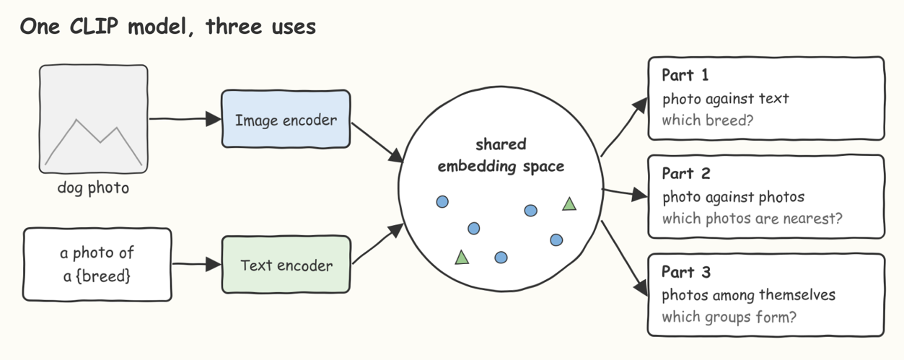
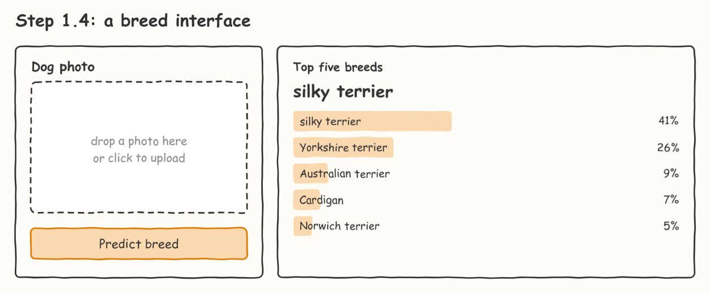
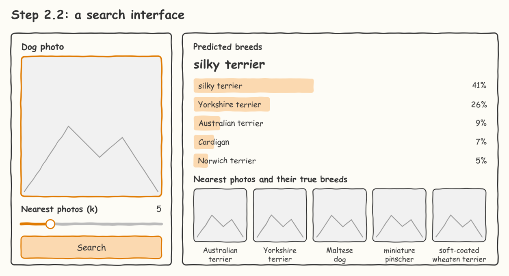
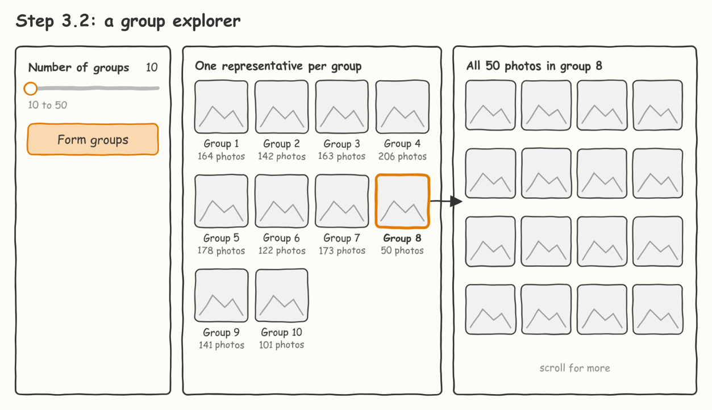

<!-- page 1 of 11 -->

# CIS341 Assignment 2: Zero-shot learning with CLIP

| Part | Topic | Marks |
| --- | --- | --- |
| 1 | Zero-shot classification: comparing photos with text | 60 |
| 2 | Image retrieval: comparing photos with photos | 20 |
| 3 | Clustering: letting photos form their own groups | 20 |

## MOTIVATION

In Project 1, every weather class needed hundreds of labelled photos and a training run before our model could recognise it, and adding a new class meant collecting more photos and training again. In this assignment, we train nothing at all. CLIP learned from a very large collection of photos and their captions to place images and text in one shared embedding space, where a photo and a sentence that describes it end up close together. This lets us compare a photo with a sentence, or with another photo, using the cosine similarity we met when we studied word vectors. When we classify photos into classes that we describe only in words, without showing the model a single labelled example, we call it **zero-shot classification**.

We will test how far this idea goes on the Stanford Dogs dataset, which contains 20,580 photos of 120 dog breeds. Many of these breeds look nearly identical, even to people, so the dataset is a demanding test of fine-grained recognition (we recommend you to have a look yourself). Because CLIP's weights never change in this assignment, the only thing we control is the text we write for each breed. Our prompts therefore decide how well CLIP does, and much of Part 1 is about designing and testing them.

In Part 2, we put the text aside and search with a photo instead. Given an arbitrary dog photo uploaded, we ask which photos in the dataset CLIP considers most similar, and whether they show the same breed. In Part 3, we remove even the query. We let the image embeddings sort the photos into groups on their own, and we build an interface to explore the groups that form. By the end, we should be able to explain what CLIP's shared space captures, what it misses and how much our prompts matter.

<!-- page 2 of 11 -->

The CLIP lab and the CLIP lectures introduce everything we need for Part 1. The Stanford Dogs walkthrough in the lecture shows what the dataset contains. The retrieval lab shows how to search with embeddings and how to build a Gradio gallery, which we will use in Parts 2 and 3.

## GETTING STARTED

We use one CLIP model for all three parts, so that the photo vectors we compute in Part 1 can be reused in Parts 2 and 3. We suggest `ViT-B/32`, the model from the CLIP lab. You may choose a larger CLIP model if you state it at the top of your notebook; your choice does not affect your marks.

Our course copy of Stanford Dogs is a 782 MB ZIP file with one folder of photos for each breed. Put it in your Google Drive, and unzip it onto Colab's local disk, because reading photos one at a time from Drive is much slower. The ZIP file also contains the dataset's official `train_list.txt` and `test_list.txt`. Those lists exist so that a trained classifier can be tested on photos it has never seen. Zero-shot classification trains nothing, so we do not need them, and in Part 1 we classify every photo in the dataset.

Parts 2 and 3 use a smaller set of 1,440 photos, 12 from each breed, which are listed in `subset_list.txt` on the assignment's Moodle page. With fewer photos, the interfaces respond quickly and we can look through the results by eye. Because everyone uses the same photos, we can also compare our results with each other. Each line of the file names one photo by its breed folder and file name, such as `n02085620-Chihuahua/n02085620_11477.jpg`, in the same form as the official lists.

Encoding the photos is the slowest part of the assignment, and Colab can restart at any moment. Use a GPU runtime, try 100 photos first to estimate the time, and then encode each photo once. We suggest to save the vectors on Drive together with their file paths, so that after a restart you can reload them instead of encoding again. On Colab's T4 GPU, encoding all 20,580 photos took us a few minutes.

Please show readable results throughout, with photos and breed names where they help. Raw lists, tensors or file paths on their own lose marks in the step they belong to.

<!-- page 3 of 11 -->

## PART 1: ZERO-SHOT CLASSIFICATION (60%)

To classify a photo without training a classifier, we write one sentence, or prompt, for each breed. We encode all 120 prompts with CLIP's text encoder, encode the photo with the image encoder, and choose the breed whose prompt is closest to the photo. In this part, we build this classifier step by step, turn it into an interface, measure it on every photo in the dataset and then test whether a different prompt does better.

### Step 1.1: The breed list (5%)

We start with the list of 120 breed names that the prompts will be built from. Each folder name gives one breed, but not in a form that CLIP will read well. A name such as `n02085620-Chihuahua` begins with an ImageNet code, and others, such as `n02097658-silky_terrier`, join their words with underscores. Decide what text should reach CLIP and build the list from the folder names. You may also type the list by hand if you prefer.

The true label of each photo also comes from its folder, so position `i` in your list must mean the same breed as label `i` in your answers. If the two orders differ, every accuracy you report will be wrong, and no error message will warn you. Show a check that they agree, for example by printing a few folder names beside the breed names at the same positions.

### Step 1.2: A set of prompts (5%)

CLIP learned from captions that people wrote for their photos, so a breed name on its own looks quite different from the text CLIP saw during training. Placing the name in a short sentence makes it read more like a caption. In the CLIP lecture, we wrote prompts such as "a photo of a dog", and the same idea gives us a template for the breeds: "a photo of a {breed}.", where `{breed}` is replaced by each name in your list.

| Breed | Prompt |
| --- | --- |
| Chihuahua | a photo of a Chihuahua. |
| silky terrier | a photo of a silky terrier. |
| Bernese mountain dog | a photo of a Bernese mountain dog. |

Choose one template and use it for all 120 breeds, so that each breed has exactly one prompt and no breed is described more favourably than another. You may start from the example above or write your own. Print a few of your prompts and explain why you chose this template. OpenAI's prompt notebook lists the templates that CLIP's authors used for ImageNet and may give you more ideas.

### Step 1.3: Classifying one photo (10%)

Now we can classify a photo. Write a function `predict_breed(image_path, k=5)` that returns the `k` most likely breeds in order, as a list of `(breed, score)` pairs. We may call this function with our own photos when we mark your work. The CLIP lab used each of the steps below, and here we put them together:

<!-- page 4 of 11 -->

1. Encode the prompts. Tokenise the 120 prompts, encode them with CLIP's text encoder and normalise each vector to length 1. The prompts stay the same from photo to photo, so we do this once, outside the function.
2. Encode the photo. Open the photo, convert it to RGB, apply CLIP's preprocessing, encode it with the image encoder and normalise the vector.
3. Compare by cosine similarity. Because every vector has length 1, the cosine similarity between the photo and a prompt is simply their dot product, and one matrix multiplication gives all 120 similarities at once.
4. Rank the breeds. Sort the breeds by similarity. The most similar breed is the prediction, and the first `k` breeds form the top-`k` list. The score can be the cosine similarity itself or the softmax probability we computed in the CLIP lab; say which one you use.

For a photo whose breed we know, the prediction is correct at top-1 if the true breed comes first, and correct at top-5 if the true breed is among the five most similar breeds. Show your function working on three photos from the dataset, with each true breed beside the predictions and whether each photo counts as correct at top-1 and at top-5.

### Step 1.4: A breed interface (5%)

A function is hard for other people to try, so we wrap `predict_breed` in a Gradio interface. Build an interface that accepts a photo and shows the top five breeds with their scores, using `gr.Label`. Test it with three dog photos from outside the dataset, and then with one photo that does not show a dog. What does CLIP do with that last photo, and why?

Because the interface calls `predict_breed`, it uses whichever prompts you choose at the end of Step 1.6, so take your screenshots after you have made that choice. Gradio interfaces do not survive in a saved notebook, so paste the screenshots of your tests into it. In Colab, `launch()` also prints a public link. Opening it in a new browser tab gives the interface the whole window, which makes clearer screenshots.

The figure shows the layout we have in mind. You may arrange yours differently, as long as the photo and the five named scores are easy to read.

<!-- page 5 of 11 -->

### Step 1.5: The evaluation (25%)

A few examples cannot tell us how well the classifier works, so we now classify every photo in the dataset with your prompts from Step 1.2. You do not need to call `predict_breed` 20,580 times. Use the photo vectors you saved, and one matrix multiplication with the prompt vectors classifies all of them in the same way. Report three numbers over all 20,580 photos:

- Top-1 accuracy: the share of photos whose true breed is ranked first.
- Top-5 accuracy: the share of photos whose true breed is among the five highest.
- Macro-averaged F1, defined below.

Accuracy counts every photo equally, so breeds with more photos count for more, and in this dataset a breed has between 148 and 252 photos. Accuracy can also look reasonable while CLIP sends the photos of several breeds to a few favourite breeds and hardly ever predicts others. Macro F1 looks at each breed separately and gives every breed the same weight. It uses the top-1 prediction for each photo, and for each breed we compute:

- precision: the number of photos correctly predicted as this breed, divided by the number of all photos predicted as this breed;
- recall: the number of photos of this breed that were predicted correctly, divided by the number of all photos of this breed;
- F1 = 2 × precision × recall / (precision + recall).

These statistics are already introduced in your Machine Learning course. If CLIP never predicts a breed, or never predicts it correctly, that breed's F1 is 0. Macro F1 is the plain average of the 120 F1 values. You may compute it yourself or with scikit-learn's `f1_score(y_true, y_pred, average="macro", zero_division=0)`, which follows the same definition.

You may start with a small subset of photos while you test your code, but the numbers you submit must come from every photo (that is, the 20,580 image). Results from a subset earn no marks in this step. As a rough guide, our own trial with `ViT-B/32` and a sensible prompt reached about 55 to 60% top-1 and 85 to 90% top-5 over the whole dataset. A result far below this usually points to a bug, such as a breed list in a different order from the labels. Your marks do not depend on reaching or beating it.

### Step 1.6: Comparing two prompts (10%)

Write a second template that differs from your first, apply it to all 120 breeds and print a few of the new prompts. Then run the whole evaluation from Step 1.5 again on every photo. Report both sets of prompts in one table with their top-1, top-5 and macro F1, and choose the set that your interface will use.

Finally, **explain in your own words why different prompts can give different results**, even though CLIP and the photos stay the same. Think about the text that CLIP saw during training, and about breed names that can also mean something other than a dog.

A template should suit every breed and most photos. "A close-up of a {breed}" does not describe many of these photos, and "a photo of a large {breed}" does not suit a Chihuahua. Use one template for all 120 breeds, because mixing templates across breeds would make the comparison meaningless.

<!-- page 6 of 11 -->

## PART 2: IMAGE RETRIEVAL (20%)

Now we leave the text encoder out. If CLIP's image encoder places similar photos close together, the photos nearest to a dog photo should often show the same breed. This gives us a search engine that works by example: instead of typing a description, we show it a photo and ask for photos like it. The search itself uses no breed names. We use the true breeds only afterwards, as captions, to see whether the nearest photos agree with the breeds that Part 1 predicts for the same photo.

In this part, we search the 1,440 photos listed in `subset_list.txt`. You encoded them already in Part 1, so you only need to select their vectors and file paths from your saved file.

### Step 2.1: Searching by photo (8%)

Write a function `find_similar(image_path, k=5)` that encodes the query photo in the same way as in Step 1.3, compares it with every subset photo by cosine similarity and returns the `k` most similar photos in order, as a list of `(path, breed, score)` tuples. As with `predict_breed`, we may call this function with our own photos. Show it working on one photo, and display the nearest photos with their breeds and scores rather than only their paths.

### Step 2.2: A search interface (8%)

Build a Gradio interface for the search. A user uploads any dog photo and chooses with a slider how many nearest photos to return. The interface then shows two results together: the top five breeds that `predict_breed` gives for the uploaded photo, using `gr.Label`, and the `k` nearest subset photos in a `gr.Gallery`, each captioned with its true breed. The retrieval lab built a similar gallery, so you can start from its code.

When the captions agree with the predicted breeds, the text route and the image route have reached the same answer in different ways. When they disagree, look at what the nearest photos share instead, such as the pose, the colour or the background.

<!-- page 7 of 11 -->

### Step 2.3: Testing the search (4%)

Test your interface with three different dog photos, using two values of `k` for each, such as 5 and 10. The photos may come from the dataset or from elsewhere. Paste the six screenshots into your notebook, and under each one, write a sentence or two on whether the nearest photos agree with the predicted breeds.

## PART 3: CLUSTERING (20%)

So far, every search has started from a question, either a sentence or a photo. Clustering has no question and uses no labels, and it forms groups from similarity alone. By looking at the groups that form, we can see what the image embeddings actually pay attention to. For this part, please forget about the breed labels. We look for the dominant groups among the photos and describe what holds each of them together.

We again use the 1,440 photos in `subset_list.txt`, so that each group stays small enough to look through.

### Step 3.1: Forming the groups (5%)

We use k-means, a simple clustering method. It starts with a chosen number of group centres and assigns each photo to its nearest centre. It then moves each centre to the average of the photos assigned to it, and repeats these two steps until the groups stop changing. With scikit-learn, this takes only a few lines:

1. Take the normalised vectors of the 1,440 subset photos. Because each vector has length 1, the distance between two photos depends only on their cosine similarity, so k-means groups the photos by the same similarity that we used in Parts 1 and 2.
2. Run k-means, for example `KMeans(n_clusters=10, random_state=341, n_init=10).fit_predict(vectors)`, which gives a group number for every photo. Fixing `random_state` gives the same groups every time you run the cell.
3. Count the photos in each group, for example with `np.bincount`, and show the group sizes.
4. Choose a representative photo for each group. We suggest the group's own photo that is closest to its centre, because it shows what the group is most about, while a randomly chosen photo may be unusual for its group. `KMeans.transform` gives the distance from every photo to every centre. For each group, compare only the distances of its own photos, because the photo nearest to a centre can sometimes belong to a different group. If you choose a different way, explain why.

Put these steps in a function that takes the number of groups, so that your interface in Step 3.2 can call it. Show the group sizes and the representative photos for 10 groups.

### Step 3.2: A group explorer (8%)

To explore the groups, build a Gradio interface with three columns:

- On the left, a slider for the number of groups and a button that forms the groups. We suggest a range of 10 to 50 groups, but you may change it.
- In the middle, a `gr.Gallery` with one representative photo for each group, captioned with the group number and the number of photos in the group.

<!-- page 8 of 11 -->

- On the right, a second `gr.Gallery` that shows all the photos in a group when you select its representative in the middle.

Lay out the columns with `gr.Row` and `gr.Column`. Colab shows the interface in a narrow frame, where the three columns may wrap below each other. Open the public link that `launch()` prints in a new browser tab and take your screenshots there, or give each column a smaller `min_width`. When you click a picture, the gallery's `select` event passes its position to your function through `gr.SelectData`, and a `gr.State` can keep the current groups between clicks. The retrieval lab uses both. Setting `allow_preview=False` on the middle gallery makes a click select the photo instead of enlarging it. Forming the groups again takes a few seconds on the 1,440 photos. This interface is a small challenge, and we hope you enjoy building it.

### Step 3.3: Finding the dominant groups (7%)

Use your explorer with two settings, such as 10 and 40 groups. For each setting, paste a screenshot with one group opened on the right. Then describe the dominant groups you found. Which groups are large, which contain photos that look much alike, and what holds each of them together, such as the coat, the colour, the pose, the setting or the people in the photos? Describe what you see in the photos rather than naming breeds.

## SUBMISSION REQUIREMENTS

Submit one executed `.ipynb` notebook with its saved outputs, containing all three parts in order. Write your explanations beside the results they discuss, and paste the screenshots of your three interfaces beside the code that builds them. You do not need to submit a report, a video, the dataset or your saved vectors.

<!-- page 9 of 11 -->

If you use photos from outside the dataset, say where they came from. Cite any third-party code or reference right after the cell that uses it.

## AI DISCLOSURE

We allow AI assistance, but need to understand what you delegated and what you checked yourself. Disclosure is mandatory for each of the three parts.

Explain in your notebook which tool you used, the specific problem you asked it to solve, and whether the suggestion worked when you tested it. If you did not use AI for a part, say so.

**Missing or inadequate disclosure can lose up to 25 percentage points across the assignment.** A tool name followed by "helped with coding" is insufficient. Do not claim checks you have not performed.

## DEADLINE AND SUBMISSION CHECKS

**Deadline: Sunday, 29 November 2026, 23:59 (Hong Kong time).** Late submissions lose 20% per day, for up to five days.

Please click "Submit assignment" on Moodle and confirm that the status is "Submitted for grading". An attempt left in draft status is not a completed submission.

We will check submissions after the deadline. Your notebook must open and must contain executed outputs with enough evidence of the results you report. Any further instructions will be given in your grading comments.

## ACADEMIC INTEGRITY

This assignment must be completed individually. Plagiarism and code sharing are violations that result in a grade of zero and further disciplinary action.

## APPENDIX A: MARKING RUBRIC

### A.1 What earns the marks

| Step | What earns the marks | Marks |
| --- | --- | --- |
| 1.1 | 120 readable breed names, from the folders or typed | 3 |
| 1.1 | A shown check that list positions and labels agree | 2 |
| 1.2 | One template applied to all 120 breeds, with printed examples | 3 |
| 1.2 | A reason for choosing the template | 2 |
| 1.3 | Correct CLIP preparation of photo and text, and comparison by cosine similarity | 6 |

<!-- page 10 of 11 -->

| Step | What earns the marks | Marks |
| --- | --- | --- |
| 1.3 | predict_breed returns named breeds and scores in order, and copes with non-RGB files | 2 |
| 1.3 | Three readable examples with true and predicted breeds, marked correct or not at top-1 and top-5 | 2 |
| 1.4 | A working interface showing the top five breeds through gr.Label | 2 |
| 1.4 | Screenshots of three dog photos from outside the dataset | 2 |
| 1.4 | A photo without a dog, with a comment on the result | 1 |
| 1.5 | Correct top-1 accuracy over every photo | 7.5 |
| 1.5 | Correct top-5 accuracy over every photo | 5 |
| 1.5 | Correct macro F1 over every photo | 5 |
| 1.5 | Completeness in workflow and end-to-end running of the evaluation codes | 7.5 |
| 1.6 | A second complete set of 120 prompts from a different template, with printed examples | 3 |
| 1.6 | Top-1, top-5 and macro F1 for both sets over every photo, in one table, with an explanation of why different prompts can give different results | 7 |
| 2.1 | find_similar compares by cosine similarity and returns named results in order | 5 |
| 2.1 | One readable example showing the nearest photos | 3 |
| 2.2 | An interface with a photo upload and a slider for k | 2 |
| 2.2 | The top five predicted breeds through gr.Label | 2 |
| 2.2 | A gallery of the k nearest photos, captioned with their true breeds | 4 |
| 2.3 | Screenshots of three photos at two values of k | 2 |
| 2.3 | A short comment under each screenshot | 2 |
| 3.1 | k-means on the subset vectors with a fixed seed, in a function that takes the number of groups | 3 |
| 3.1 | Group sizes and representative photos shown for 10 groups | 2 |
| 3.2 | Three columns, with the number of groups set on the left | 2 |
| 3.2 | A gallery of representatives captioned with group numbers and sizes | 2 |
| 3.2 | Selecting a representative shows all the photos of its group | 4 |
| 3.3 | Screenshots at two settings, each with one group opened | 2 |
| 3.3 | A description of the dominant groups, based on the photos | 5 |

<!-- page 11 of 11 -->

### A.2 Missing work and unsupported claims

- Code without executed outputs earns only the implementation marks for that step.
- A number from a partial run does not earn marks for the full dataset, even if the code would process it.
- Claims that conflict with your outputs receive no credit for the results they describe. A carefully tested result that is disappointing still earns its marks.
- We assess what your submitted notebook actually shows, without an extra flat penalty for a fault already reflected in its step.

## APPENDIX B: DATASET CREDIT

Stanford Dogs was created by Aditya Khosla, Nityananda Jayadevaprakash, Bangpeng Yao and Li Fei-Fei from ImageNet images and annotations: "Novel Dataset for Fine-Grained Image Categorization", First Workshop on Fine-Grained Visual Categorization, CVPR 2011. Dataset page.
