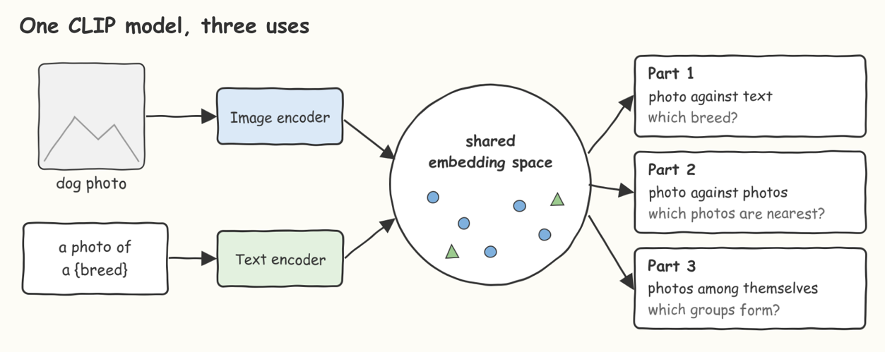
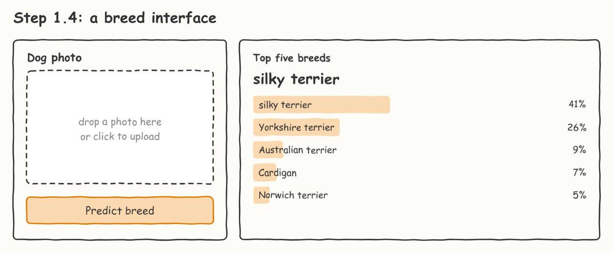
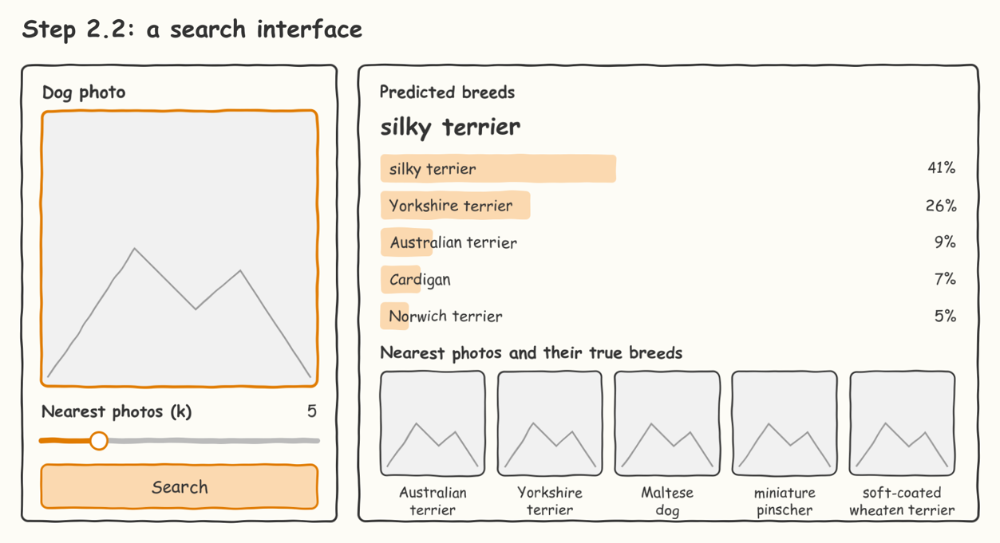
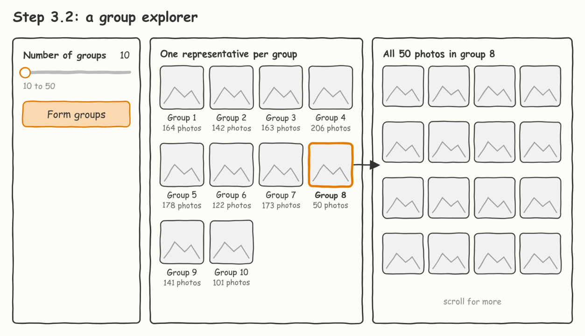

<!-- page 1 of 11 -->

# CIS341 作業二：使用 CLIP 進行零樣本學習

| 部分 | 主題 | 分數 |
| --- | --- | --- |
| 1 | 零樣本分類：比較照片與文字 | 60 |
| 2 | 圖像檢索：比較照片與照片 | 20 |
| 3 | 分群：讓照片自行形成群組 | 20 |

## 動機

在專案一中，每一個天氣類別都需要數百張標註過的照片，並經過一次訓練，我們的模型才能辨認它；而每新增一個類別，就得再收集更多照片並重新訓練。這次作業我們完全不訓練任何東西。CLIP 從極大量照片及其說明文字中學習，把圖像與文字放進同一個共享的嵌入空間，其中一張照片與描述它的句子會落在彼此附近。這讓我們能用研究詞向量時學過的餘弦相似度，將一張照片與一句話比較，或與另一張照片比較。當我們只以文字描述類別、完全不給模型任何標註範例，就把照片分類到這些類別時，稱為**零樣本分類**。

我們將在 Stanford Dogs 資料集上測試這個想法能走多遠，該資料集包含 120 個犬種、共 20,580 張照片。其中許多犬種即使對人來說也幾乎一模一樣，因此這個資料集是細粒度辨識的嚴苛考驗（建議你親自看一看）。由於本作業中 CLIP 的權重始終不變，我們唯一能控制的就是為每個犬種所寫的文字。因此，我們所寫的提示詞（prompt）決定了 CLIP 的表現，而第一部分有很大一部分就是在設計與測試這些提示詞。

在第二部分，我們把文字放到一邊，改用照片來搜尋。給定一張任意上傳的狗照片，我們詢問 CLIP 認為資料集中哪些照片最相似，以及它們是否為同一犬種。在第三部分，我們連查詢都移除。我們讓圖像嵌入自行把照片分成群組，並建立一個介面來探索所形成的群組。到最後，我們應該能夠說明 CLIP 的共享空間捕捉了什麼、漏掉了什麼，以及我們的提示詞有多重要。

<!-- page 2 of 11 -->

CLIP 實驗課與 CLIP 講課介紹了第一部分所需的全部內容。課堂上的 Stanford Dogs 導覽說明了該資料集包含什麼。檢索實驗課則示範如何用嵌入進行搜尋，以及如何建立 Gradio 藝廊，我們將在第二、三部分使用。

## 開始之前

三個部分都使用同一個 CLIP 模型，這樣第一部分算出的照片向量就能在第二、三部分重複使用。我們建議使用 `ViT-B/32`，也就是 CLIP 實驗課所用的模型。若你在 notebook 最上方註明，也可以選擇更大的 CLIP 模型；你的選擇不影響分數。

本課程的 Stanford Dogs 副本是一個 782 MB 的 ZIP 檔，每個犬種一個照片資料夾。請將它放進你的 Google Drive，並解壓縮到 Colab 的本機磁碟，因為從 Drive 一張一張讀取照片會慢得多。該 ZIP 檔也包含資料集官方的 `train_list.txt` 與 `test_list.txt`。這些清單的存在，是為了讓訓練好的分類器能在它從未見過的照片上接受測試。零樣本分類不訓練任何東西，所以我們不需要它們；在第一部分，我們會對資料集中的每一張照片進行分類。

第二、三部分使用一個較小的集合，共 1,440 張照片，每個犬種 12 張，列於作業 Moodle 頁面的 `subset_list.txt` 中。照片較少時，介面回應快速，我們也能用肉眼瀏覽結果。由於大家使用相同的照片，我們也能彼此比較結果。該檔案的每一行以犬種資料夾與檔名指定一張照片，例如 `n02085620-Chihuahua/n02085620_11477.jpg`，格式與官方清單相同。

編碼照片是本作業最耗時的部分，而 Colab 隨時可能重新啟動。請使用 GPU 執行環境，先試 100 張照片以估計時間，然後每張照片只編碼一次。我們建議把向量連同其檔案路徑存到 Drive，這樣重新啟動後就能重新載入，而不必再次編碼。在 Colab 的 T4 GPU 上，編碼全部 20,580 張照片花了我們幾分鐘。

請在整份作業中呈現易讀的結果，在有用之處附上照片與犬種名稱。只有原始清單、張量或檔案路徑本身，會在該步驟失分。

<!-- page 3 of 11 -->

## 第一部分：零樣本分類（60%）

要在不訓練分類器的情況下分類一張照片，我們為每個犬種寫一句話，也就是提示詞。我們用 CLIP 的文字編碼器編碼全部 120 個提示詞，用圖像編碼器編碼照片，然後選擇提示詞與照片最接近的犬種。在這一部分，我們逐步建立這個分類器，把它變成一個介面，在資料集中的每張照片上衡量它，然後測試不同的提示詞是否表現更好。

### 步驟 1.1：犬種清單（5%）

我們從提示詞將據以建立的 120 個犬種名稱清單開始。每個資料夾名稱給出一個犬種，但並非 CLIP 能良好讀取的形式。像 `n02085620-Chihuahua` 這樣的名稱以 ImageNet 代碼開頭，而其他如 `n02097658-silky_terrier` 則用底線連接詞語。請決定應該送進 CLIP 的是什麼文字，並從資料夾名稱建立清單。若你偏好，也可以手動輸入清單。

每張照片的真實標籤也來自其資料夾，因此你清單中位置 `i` 的犬種，必須與你答案中標籤 `i` 的犬種相同。若兩者順序不同，你報告的每一個準確率都會是錯的，而且不會有任何錯誤訊息警告你。請展示一項檢查以確認兩者一致，例如在同一位置並列印出幾個資料夾名稱與犬種名稱。

### 步驟 1.2：一組提示詞（5%）

CLIP 是從人們為照片所寫的說明文字中學習的，所以單獨一個犬種名稱，看起來與 CLIP 訓練時所見的文字相當不同。把名稱放進一個短句中，會使它讀起來更像說明文字。在 CLIP 講課中，我們寫過如 "a photo of a dog" 的提示詞，同樣的想法給了我們犬種的模板："a photo of a {breed}."，其中 `{breed}` 由你清單中的每個名稱替換。

| 犬種 | 提示詞 |
| --- | --- |
| Chihuahua | a photo of a Chihuahua. |
| silky terrier | a photo of a silky terrier. |
| Bernese mountain dog | a photo of a Bernese mountain dog. |

請選擇一個模板並套用於全部 120 個犬種，使每個犬種恰好有一個提示詞，且沒有犬種被描述得比另一個更有利。你可以從上述範例出發，或自行撰寫。請印出幾個提示詞，並說明你為何選擇這個模板。OpenAI 的提示詞 notebook 列出了 CLIP 作者用於 ImageNet 的模板，或許能給你更多靈感。

### 步驟 1.3：分類一張照片（10%）

現在我們可以分類一張照片了。請撰寫函式 `predict_breed(image_path, k=5)`，依序列出 `k` 個最可能的犬種，形式為 `(breed, score)` 配對的清單。我們在評分時可能會用我們自己的照片呼叫此函式。CLIP 實驗課用過下列每一步，這裡我們把它們組合起來：

<!-- page 4 of 11 -->

1. 編碼提示詞。將 120 個提示詞斷詞（tokenise），用 CLIP 的文字編碼器編碼，並將每個向量正規化為長度 1。提示詞從一張照片到另一張都不變，所以我們在函式外只做一次。
2. 編碼照片。開啟照片、轉為 RGB、套用 CLIP 的前處理，用圖像編碼器編碼，並將向量正規化。
3. 以餘弦相似度比較。由於每個向量長度為 1，照片與提示詞之間的餘弦相似度就是它們的內積，而一次矩陣乘法就能同時得到全部 120 個相似度。
4. 為犬種排序。依相似度排序犬種。最相似的犬種即為預測，前 `k` 個犬種構成 top-`k` 清單。分數可以是餘弦相似度本身，或我們在 CLIP 實驗課算過的 softmax 機率；請說明你使用哪一種。

對於犬種已知的照片，若真實犬種排第一，則 top-1 預測正確；若真實犬種位於最相似的五個之中，則 top-5 正確。請展示你的函式在資料集三張照片上的運作，並在預測旁標出各照片的真實犬種，以及在 top-1 與 top-5 是否算正確。

### 步驟 1.4：犬種介面（5%）

函式對其他人來說不易試用，所以我們把 `predict_breed` 包進一個 Gradio 介面。建立一個接受照片、並以 `gr.Label` 顯示前五名犬種及其分數的介面。用三張資料集以外的狗照片測試，然後再用一張不是狗的照片測試。CLIP 對最後那張照片做了什麼？為什麼？

由於介面會呼叫 `predict_breed`，它會使用你在步驟 1.6 最後所選的提示詞，所以請在那項選擇完成後再截圖。Gradio 介面在儲存的 notebook 中不會保留，因此請把測試的截圖貼進 notebook。在 Colab 中，`launch()` 也會印出一個公開連結。在新瀏覽器分頁中開啟它，介面就能佔滿整個視窗，使截圖更清晰。

圖中展示了我們設想的版面。你可以用不同的排列，只要照片與五個具名分數易於閱讀即可。

<!-- page 5 of 11 -->

### 步驟 1.5：評估（25%）

少數幾個例子無法告訴我們分類器表現多好，所以我們現在用你在步驟 1.2 的提示詞分類資料集中的每一張照片。你不需要呼叫 `predict_breed` 20,580 次。使用你儲存好的照片向量，一次與提示詞向量的矩陣乘法就能以相同方式分類全部照片。請報告全部 20,580 張照片的三個數字：

- Top-1 準確率：真實犬種排名第一的照片比例。
- Top-5 準確率：真實犬種位於前五名的照片比例。
- 宏平均 F1（macro-averaged F1），定義如下。

準確率對每張照片一視同仁，因此照片較多的犬種佔比較重，而此資料集中每個犬種有 148 到 252 張照片。準確率也可能看起來合理，但 CLIP 卻把好幾個犬種的照片都送到少數幾個偏好的犬種，而幾乎從不預測其他犬種。宏 F1 分別檢視每個犬種，並給每個犬種相同權重。它使用每張照片的 top-1 預測，並對每個犬種計算：

- precision（精確率）：被正確預測為此犬種的照片數，除以所有被預測為此犬種的照片數；
- recall（召回率）：此犬種中被正確預測的照片數，除以此犬種的全部照片數；
- F1 = 2 × precision × recall / (precision + recall)。

這些統計量在你的機器學習課程中已經介紹過。若 CLIP 從不預測某犬種，或從未正確預測它，該犬種的 F1 為 0。宏 F1 就是 120 個 F1 值的簡單平均。你可以自行計算，或使用 scikit-learn 的 `f1_score(y_true, y_pred, average="macro", zero_division=0)`，其定義相同。

你在測試程式碼時可以先從一小部分照片開始，但你提交的數字必須來自每一張照片（也就是 20,580 張）。來自子集的結果在此步驟不得分。作為粗略參考，我們自己用 `ViT-B/32` 與一個合理的提示詞所做的試驗，在整個資料集上達到約 55% 至 60% 的 top-1 與 85% 至 90% 的 top-5。遠低於此的結果通常指向程式錯誤，例如犬種清單順序與標籤不同。你的分數不取決於是否達到或超越此水準。

### 步驟 1.6：比較兩個提示詞（10%）

撰寫第二個與第一個不同的模板，套用於全部 120 個犬種，並印出幾個新的提示詞。然後在每張照片上重新執行步驟 1.5 的完整評估。在同一個表格中報告兩組提示詞及其 top-1、top-5 與宏 F1，並選擇你的介面將使用的那一組。

最後，**用你自己的話解釋為什麼不同的提示詞會給出不同結果**，即使 CLIP 與照片都相同。想想 CLIP 訓練時所見的文字，以及那些除了狗之外也可能代表其他意思的犬種名稱。

模板應適合每個犬種與大多數照片。"A close-up of a {breed}" 並不描述這些照片中的許多張，而 "a photo of a large {breed}" 不適合 Chihuahua。請對全部 120 個犬種使用同一個模板，因為在不同犬種間混用模板會使比較失去意義。

<!-- page 6 of 11 -->

## 第二部分：圖像檢索（20%）

現在我們把文字編碼器放到一邊。若 CLIP 的圖像編碼器把相似的照片放得接近，那麼一張狗照片附近最近的照片應該經常是同一犬種。這給了我們一個以範例運作的搜尋引擎：不是輸入描述，而是給它一張照片，然後要求相似的照片。搜尋本身不使用任何犬種名稱。我們只在事後把真實犬種當作說明文字使用，以檢視最近的照片是否與第一部分對同一張照片所預測的犬種一致。

在這一部分，我們搜尋列於 `subset_list.txt` 的 1,440 張照片。你在第一部分已經編碼過它們，所以只需要從儲存的檔案中選出它們的向量與檔案路徑。

### 步驟 2.1：以照片搜尋（8%）

撰寫函式 `find_similar(image_path, k=5)`，以與步驟 1.3 相同的方式編碼查詢照片，用餘弦相似度與每一張子集照片比較，並依序傳回最相似的 `k` 張照片，形式為 `(path, breed, score)` 元組的清單。如同 `predict_breed`，我們可能會用我們自己的照片呼叫此函式。請展示它在一張照片上的運作，並顯示最近的數張照片及其犬種與分數，而不只是路徑。

### 步驟 2.2：搜尋介面（8%）

為搜尋建立一個 Gradio 介面。使用者上傳任何狗照片，並用滑桿選擇要傳回幾張最近的照片。介面接著同時顯示兩項結果：用 `gr.Label` 顯示 `predict_breed` 對上傳照片給出的前五名犬種，以及在 `gr.Gallery` 中顯示 `k` 張最近的子集照片，每張以其真實犬種作為說明。檢索實驗課建立過類似的藝廊，所以你可以從它的程式碼開始。

當說明文字與預測犬種一致時，文字路線與圖像路線以不同方式得到了相同答案。當它們不一致時，看看最近的照片反而共享了什麼，例如姿勢、顏色或背景。

<!-- page 7 of 11 -->

### 步驟 2.3：測試搜尋（4%）

用三張不同的狗照片測試你的介面，每張使用兩個 `k` 值，例如 5 與 10。照片可以來自資料集或其他地方。請把六張截圖貼進 notebook，並在每張下方寫一兩句話，說明最近的照片是否與預測的犬種一致。

## 第三部分：分群（20%）

到目前為止，每次搜尋都始於一個問題，無論是一句話或一張照片。分群沒有問題，也不使用標籤，它僅憑相似度形成群組。透過觀察所形成的群組，我們可以看到圖像嵌入實際上關注什麼。在這一部分，請忘掉犬種標籤。我們尋找照片中的主要群組，並描述是什麼把每個群組凝聚在一起。

我們再次使用 `subset_list.txt` 中的 1,440 張照片，使每個群組都小到可以瀏覽。

### 步驟 3.1：形成群組（5%）

我們使用 k-means，一種簡單的分群方法。它從選定數量的群中心開始，把每張照片指派到最近的群中心。然後把每個群中心移到指派給它的照片的平均位置，並重複這兩個步驟，直到群組不再改變。使用 scikit-learn，這只需要幾行程式：

1. 取出 1,440 張子集照片的正規化向量。由於每個向量長度為 1，兩張照片之間的距離只取決於它們的餘弦相似度，因此 k-means 會以我們在第一、二部分所用的相同相似度來分群。
2. 執行 k-means，例如 `KMeans(n_clusters=10, random_state=341, n_init=10).fit_predict(vectors)`，它會為每張照片給出一個群組編號。固定 `random_state` 可使每次執行該儲存格時得到相同的群組。
3. 計算每個群組中的照片數，例如用 `np.bincount`，並顯示群組大小。
4. 為每個群組選擇一張代表照片。我們建議選擇該群組中距離其群中心最近的照片，因為它最能顯示該群組的主題，而隨機選的照片可能對該群組而言較不典型。`KMeans.transform` 給出每張照片到每個群中心的距離。對每個群組，只比較其自身照片的距離，因為離某個群中心最近的照片有時可能屬於不同的群組。若你選擇不同的方式，請說明原因。

請把這些步驟放進一個接受群組數量的函式，以便你在步驟 3.2 的介面能呼叫它。請展示 10 個群組的群組大小與代表照片。

### 步驟 3.2：群組探索器（8%）

為了探索群組，請建立一個有三欄的 Gradio 介面：

- 左側：一個群組數量滑桿，以及一個形成群組的按鈕。我們建議 10 到 50 個群組的範圍，但你可以更改。
- 中間：一個 `gr.Gallery`，每個群組一張代表照片，並以群組編號與該群組照片數作為說明。

<!-- page 8 of 11 -->

- 右側：第二個 `gr.Gallery`，當你在中間選擇某個代表時，顯示該群組的所有照片。

請用 `gr.Row` 與 `gr.Column` 配置各欄。Colab 會在狹窄的框架中顯示介面，三欄可能會換行堆疊到彼此下方。請在新瀏覽器分頁中開啟 `launch()` 印出的公開連結，並在那裡截圖，或給每一欄較小的 `min_width`。當你點擊一張圖片時，藝廊的 `select` 事件會透過 `gr.SelectData` 把它的位置傳給你的函式，而 `gr.State` 可在點擊之間保留目前的群組。檢索實驗課兩者都用到。在中間藝廊設定 `allow_preview=False`，可使點擊選取照片而不是放大它。在 1,440 張照片上重新形成群組需要幾秒鐘。這個介面是個小挑戰，我們希望你會喜歡建立它。

### 步驟 3.3：找出主要群組（7%）

用兩種設定使用你的探索器，例如 10 與 40 個群組。對每種設定，貼上一張在右側打開某個群組的截圖。然後描述你找到的主要群組。哪些群組很大、哪些群組包含看起來非常相似的照片，以及是什麼把每個群組凝聚在一起，例如毛色、顏色、姿勢、場景或照片中的人？請描述你在照片中看到的內容，而不是說出犬種名稱。

## 繳交規定

請繳交一個已執行、含已儲存輸出的 `.ipynb` notebook，依序包含全部三個部分。請在它所討論的結果旁寫下你的說明，並把三個介面的截圖貼在建立它們的程式碼旁。你不需要繳交報告、影片、資料集或你儲存的向量。

<!-- page 9 of 11 -->

若你使用資料集以外的照片，請說明它們來自何處。請在使用任何第三方程式碼或參考資料的儲存格之後立即引用。

## AI 使用揭露

我們允許 AI 協助，但需要了解你委託了什麼、以及你自己檢查了什麼。三個部分都必須揭露。

請在你的 notebook 中說明你使用了哪個工具、你請它解決的具體問題，以及該建議在你測試時是否有效。若某部分你沒有使用 AI，請說明。

**缺少或不充分的揭露，可能使整份作業最多被扣 25 個百分點。** 只寫工具名稱再加上「協助程式設計」是不夠的。請勿聲稱你未實際進行的檢查。

## 截止時間與繳交檢查

**截止時間：2026 年 11 月 29 日（星期日）23:59（香港時間）。** 逾期繳交每天扣 20%，最多扣五天。

請在 Moodle 上點擊「Submit assignment」，並確認狀態為「Submitted for grading」。停留在草稿狀態的嘗試不算完成繳交。

我們會在截止後檢查繳交內容。你的 notebook 必須能夠開啟，且必須包含已執行的輸出，並對你所報告的結果提供足夠證據。任何進一步的指示將在評分意見中給出。

## 學術誠信

本作業必須個人獨立完成。抄襲與程式碼分享屬違規行為，將導致零分及進一步的紀律處分。

## 附錄 A：評分規準

### A.1 得分要點

| 步驟 | 得分要點 | 分數 |
| --- | --- | --- |
| 1.1 | 120 個可讀的犬種名稱，來自資料夾或手動輸入 | 3 |
| 1.1 | 展示清單位置與標籤一致的檢查 | 2 |
| 1.2 | 一個套用於全部 120 個犬種的模板，並印出範例 | 3 |
| 1.2 | 選擇該模板的理由 | 2 |
| 1.3 | 正確地以 CLIP 前處理照片與文字，並以餘弦相似度比較 | 6 |

<!-- page 10 of 11 -->

| 步驟 | 得分要點 | 分數 |
| --- | --- | --- |
| 1.3 | predict_breed 依序傳回具名犬種與分數，並能處理非 RGB 檔案 | 2 |
| 1.3 | 三個易讀的範例，含真實與預測犬種，並標示 top-1 與 top-5 是否正確 | 2 |
| 1.4 | 一個可運作的介面，以 gr.Label 顯示前五名犬種 | 2 |
| 1.4 | 三張資料集以外狗照片的截圖 | 2 |
| 1.4 | 一張沒有狗的照片，並對結果加以評論 | 1 |
| 1.5 | 在每張照片上正確計算 top-1 準確率 | 7.5 |
| 1.5 | 在每張照片上正確計算 top-5 準確率 | 5 |
| 1.5 | 在每張照片上正確計算宏 F1 | 5 |
| 1.5 | 工作流程的完整性，以及評估程式碼端到端可執行 | 7.5 |
| 1.6 | 來自不同模板、另一組完整的 120 個提示詞，並印出範例 | 3 |
| 1.6 | 兩組提示詞在每張照片上的 top-1、top-5 與宏 F1，置於同一表格，並解釋為何不同提示詞會給出不同結果 | 7 |
| 2.1 | find_similar 以餘弦相似度比較，並依序傳回具名結果 | 5 |
| 2.1 | 一個易讀的範例，顯示最近的數張照片 | 3 |
| 2.2 | 具備照片上傳與 k 滑桿的介面 | 2 |
| 2.2 | 以 gr.Label 顯示前五名預測犬種 | 2 |
| 2.2 | 顯示 k 張最近照片的藝廊，以真實犬種作為說明 | 4 |
| 2.3 | 三張照片、各兩種 k 值的截圖 | 2 |
| 2.3 | 每張截圖下方的簡短評論 | 2 |
| 3.1 | 在子集向量上以固定種子執行 k-means，並包成接受群組數量的函式 | 3 |
| 3.1 | 顯示 10 個群組的群組大小與代表照片 | 2 |
| 3.2 | 三欄，左側可設定群組數量 | 2 |
| 3.2 | 代表照片藝廊，以群組編號與大小作為說明 | 2 |
| 3.2 | 選取代表照片會顯示其群組的所有照片 | 4 |
| 3.3 | 兩種設定的截圖，各打開一個群組 | 2 |
| 3.3 | 基於照片的主要群組描述 | 5 |

<!-- page 11 of 11 -->

### A.2 缺失內容與無佐證的主張

- 沒有已執行輸出的程式碼，只會得到該步驟的實作分數。
- 來自部分執行結果的數字，不會因為程式碼能處理整個資料集而得到完整資料集的分數。
- 與你的輸出相矛盾的主張，其所描述的結果不給分。經過仔細測試但令人失望的結果，仍可獲得其分數。
- 我們評估你提交的 notebook 實際顯示的內容，不會對已反映在其步驟中的缺失額外施加平扣。

## 附錄 B：資料集來源

Stanford Dogs 由 Aditya Khosla、Nityananda Jayadevaprakash、Bangpeng Yao 與 Li Fei-Fei 以 ImageNet 影像與標註建立：「Novel Dataset for Fine-Grained Image Categorization」，第一屆細粒度視覺分類工作坊（First Workshop on Fine-Grained Visual Categorization），CVPR 2011。資料集頁面。