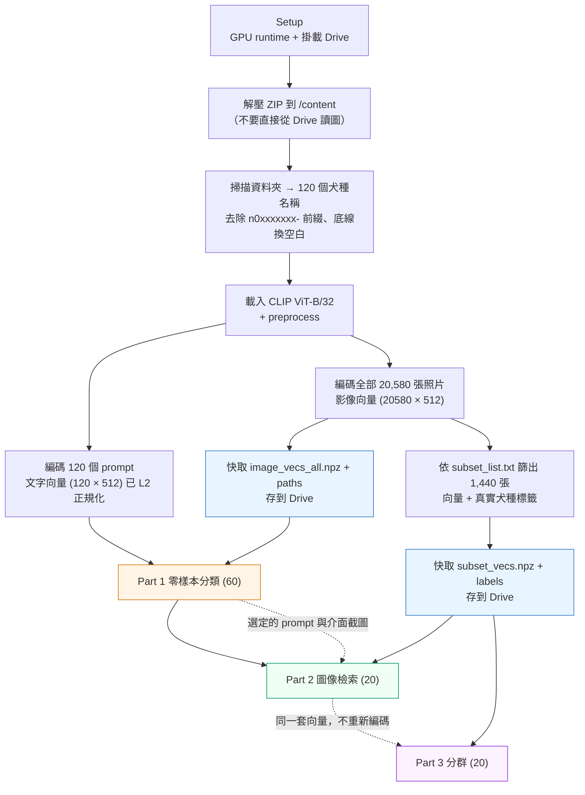
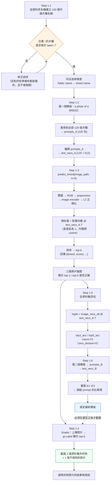
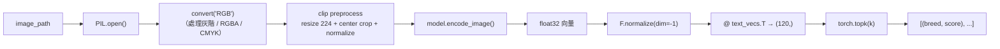
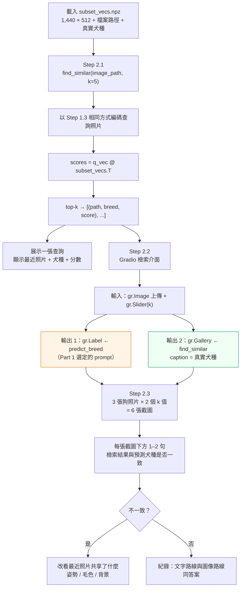
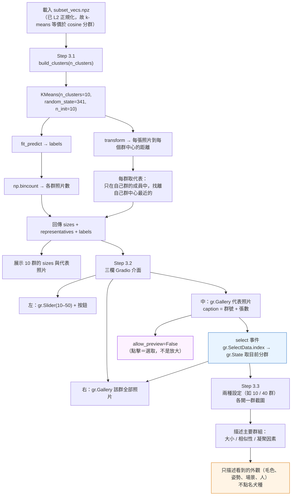
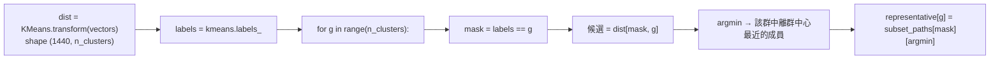

# CIS341 Assignment 2 — 實作流程圖（ipynb）

> 對應規格：[CIS341-Assignment2-2627.md](./CIS341-Assignment2-2627.md)
> 繳交物：**一個**已執行、含輸出的 `.ipynb`，三個部分依序排列。

---

## 0. 總覽：一次編碼，三處重用

本作業的關鍵結構是「**編碼只做一次，之後全部是矩陣運算**」。Part 1 算出的影像向量，被 Part 2 與 Part 3 直接載入重用。

**為什麼要快取**：Colab 隨時會斷線。重跑一次 20,580 張的編碼是本作業最貴的操作，而它的結果在三個部分都只是唯讀輸入。

---

## 1. Part 1：零樣本分類（60 分）

### 1.1 `predict_breed` 內部資料流

### 1.2 三個容易扣分的點

| 風險 | 後果 | 對策 |
| --- | --- | --- |
| 犬種清單順序與 `label` 不一致 | 全部準確率錯誤，且**沒有任何錯誤訊息** | 用 `assert` + 並排列印驗證 |
| 用子集跑出數字就交 | 1.5 該步驟 0 分 | 最終數字必須跑滿 20,580 張 |
| 1.4 截圖在 1.6 選模板之前拍 | 截圖與最終 prompt 不符 | 先完成 1.6 選定，再回頭截圖 |
| 沒有處理非 RGB 圖 | 1.3 扣 2 分 | `convert("RGB")` 一律先做 |

---

## 2. Part 2：圖像檢索（20 分）

---

## 3. Part 3：分群（20 分）

### 3.1 群組代表選擇的邏輯

> 只在自己群的成員中比較，是因為「全域最近群中心的照片」有時屬於別的群。

---

## 4. Notebook cell 順序建議

| # | 類型 | 內容 | 對應 |
| --- | --- | --- | --- |
| 1 | md | 標題、模型名稱、AI 揭露聲明摘要 | — |
| 2 | code | 掛載 Drive、解壓、列出資料夾數量 | Setup |
| 3 | code | 載入 CLIP、定義 `preprocess` / `encode_image` / `encode_text` | Setup |
| 4 | code | 編碼全部照片 + 存 `.npz`（含「已存在則載入」分支） | 共用 |
| 5 | code | 建立 subset 向量與標籤 | 共用 |
| 6 | md | `## Part 1: Zero-shot classification (60 marks)` + Must 清單 | 1 |
| 7 | code | 建立犬種清單 + `assert` 對齊檢查 | 1.1 |
| 8 | code | 模板 A → `prompts_A` → `text_vecs_A` + 印範例 | 1.2 |
| 9 | code | `predict_breed` 函式 | 1.3 |
| 10 | code | 三張照片測試（top-1 / top-5 標示） | 1.3 |
| 11 | code | 全資料集評估 Ａ（top-1 / top-5 / macro F1） | 1.5 |
| 12 | code | 模板 B → 評估 Ｂ → 比較表 → 選定 | 1.6 |
| 13 | code | Gradio 犬種介面（呼叫 `predict_breed`） | 1.4 |
| 14 | md | 截圖：3 張狗 + 1 張非狗 + 文字解釋 | 1.4 |
| 15 | md | `## Part 2: Image retrieval (20 marks)` | 2 |
| 16 | code | `find_similar` + 一張查詢結果展示 | 2.1 |
| 17 | code | Gradio 檢索介面（Image + Slider → Label + Gallery） | 2.2 |
| 18 | md | 截圖：3 照片 × 2 k 值，每張一句評論 | 2.3 |
| 19 | md | `## Part 3: Clustering (20 marks)` | 3 |
| 20 | code | `build_clusters(n)` + 10 群 sizes / 代表照片 | 3.1 |
| 21 | code | Gradio 三欄探索器（Row / Column / State / SelectData） | 3.2 |
| 22 | md | 截圖：兩種設定各開一群 + 主要群組描述 | 3.3 |
| 23 | md | AI 揭露（逐部分）、資料來源、引用 | — |

> ⚠️ cell 13 的介面依賴 cell 12 選定的模板，但截圖放在 cell 14 —— 這個「先跑、後截圖」的順序不要顛倒。

---

## 5. 快取檔案規格

| 檔案 | 內容 | shape | 用途 |
| --- | --- | --- | --- |
| `all_vecs.npz` | `vectors`, `paths` | `(20580, 512)`, `(20580,)` | 1.5 全量評估 |
| `subset_vecs.npz` | `vectors`, `paths`, `breeds` | `(1440, 512)` | 2.1、3.1 |
| `text_vecs_A.npy` | 模板 A 的 120 個向量 | `(120, 512)` | 1.3–1.5 |
| `text_vecs_B.npy` | 模板 B 的 120 個向量 | `(120, 512)` | 1.6 |

全部以 `float32` 儲存；向量一律先 `F.normalize(..., dim=-1)` 再存，事後就不必再正規化。

---

## 6. 全作業檢查清單

- [ ] 三個 Gradio 介面都有**實際跑起來**的截圖（不是 mockup）
- [ ] 1.5 的數字跑滿 20,580 張，不是示範用子集
- [ ] 兩組 prompt 的 top-1 / top-5 / macro F1 在同一張表
- [ ] 1.6 有「為什麼 prompt 不同結果不同」的自述解釋（提到訓練資料文字、歧義犬種名）
- [ ] 2.3 共 6 張截圖，每張都有評論
- [ ] 3.3 有兩組設定的截圖，且描述**不點名犬種**
- [ ] 三個部分都各自寫了 AI 揭露（工具 + 具體問題 + 是否驗證有效）
- [ ] 截圖貼在**建立該介面的 cell 旁**
- [ ] Moodle 狀態為 `Submitted for grading`（不是草稿）